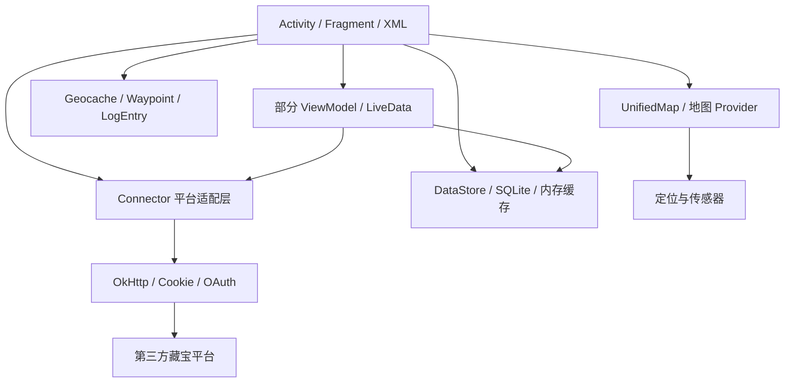
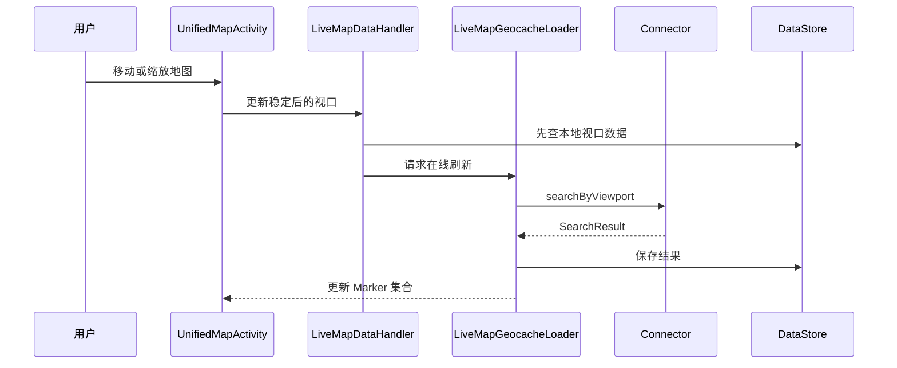
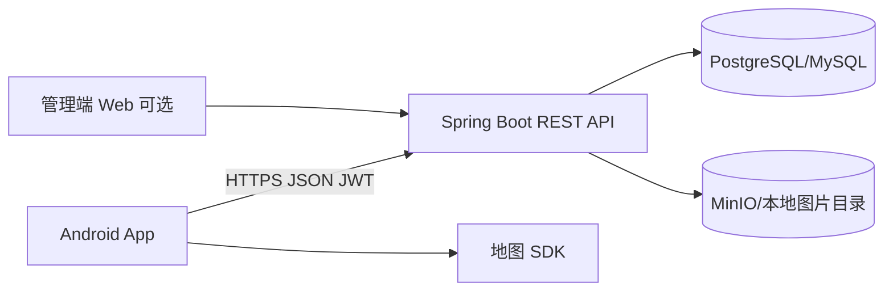
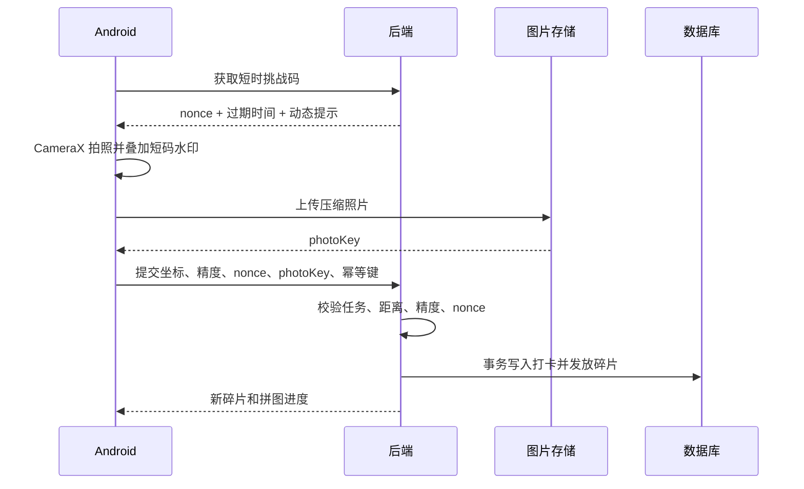

# c:geo 源码分析与“地标寻宝”项目设计

> 分析日期：2026-09-29  
> 分析对象：`cgeo-master` 本地源码。目录不含 `.git`，因此无法确认具体提交号，结论以当前文件为准。

## 1. 核心结论

c:geo 不是“手机前端 + c:geo 自有后端”的完整系统，而是一个大型 Android 原生客户端：

- 前端使用 Java、Activity/Fragment、XML、ViewBinding，地图部分使用 ViewModel/LiveData。
- 仓库中没有独立业务后端；客户端通过不同 `Connector` 直接连接 geocaching.com、OpenCaching 等平台。
- 网络层使用 OkHttp、RxJava、Jackson、Jsoup，支持 Cookie、OAuth、JSON、HTML 和文件上传。
- 本地使用 SQLite 和内存缓存实现离线藏宝点、离线日志、路线、图片等功能。
- 地图层支持 Google Maps、Mapsforge/VTM、OSM 在线瓦片和离线地图。
- 定位层支持 Google Fused Location、Android 系统定位以及罗盘传感器回退。

**不建议直接把整个 c:geo 改造成课程作业。** 当前源码约有 1315 个 Java 文件、730 个资源 XML，核心类非常庞大。更合适的做法是学习其设计思想，重新搭建一个精简的 Kotlin Android 客户端和自己的 REST 后端。

## 2. 工程规模与技术栈

`settings.gradle:50` 定义三个模块：

| 模块 | 作用 |
|---|---|
| `main` | c:geo 主应用和绝大部分业务代码 |
| `mapswithme-api` | 与 Maps.me 联动 |
| `organicmaps-api` | 与 Organic Maps 联动 |

`main/build.gradle:34` 显示当前源码使用：

- `compileSdk = 36`、`targetSdk = 36`、`minSdk = 26`
- Java 17、ViewBinding
- OkHttp 5、RxJava 3、Jackson、Jsoup
- AndroidX ViewModel、LiveData、WorkManager
- Google Play Services Location/Maps
- Mapsforge、VTM、JTS

本地统计：Java 1315 个、Kotlin 0 个、资源 XML 730 个、单元测试 102 个、Android/集成测试 217 个。

最大文件包括：

| 文件 | 约行数 | 说明 |
|---|---:|---|
| `storage/DataStore.java` | 5606 | SQLite、缓存、查询和迁移 |
| `CacheDetailActivity.java` | 2649 | 藏宝点详情页 |
| `settings/Settings.java` | 2348 | 全局设置 |
| `models/Geocache.java` | 2257 | 核心领域模型 |
| `CacheListActivity.java` | 1809 | 列表、筛选、排序 |
| `connector/gc/GCParser.java` | 1764 | GC 数据解析 |
| `unifiedmap/UnifiedMapActivity.java` | 1437 | 地图主页面 |

## 3. 总体架构



c:geo 不是严格的 MVC/MVP/MVVM。地图部分已经使用 ViewModel，但大量 Activity 仍直接调用连接器和 `DataStore`，属于长期演化形成的混合架构。

## 4. 主要模块分析

### 4.1 应用入口与界面

核心文件：

- `main/src/main/java/cgeo/geocaching/MainActivity.java:99`
- `main/AndroidManifest.xml:101`
- `main/src/main/res/layout/`

`MainActivity` 负责主页入口、地图、藏宝列表、搜索、历史、设置、配置向导和外部链接。界面主要是传统 XML View，不是 Jetpack Compose。

### 4.2 藏宝点模型、列表和详情

核心文件：

- `main/src/main/java/cgeo/geocaching/models/Geocache.java`
- `main/src/main/java/cgeo/geocaching/CacheListActivity.java:148`
- `main/src/main/java/cgeo/geocaching/CacheDetailActivity.java:193`
- `main/src/main/java/cgeo/geocaching/models/Waypoint.java`

`Geocache` 保存编号、名称、描述、经纬度、难度、类型、所有者、图片、日志、属性、途经点、收藏和找到状态等。部分属性会直接通过 `DataStore` 懒加载，说明模型与持久化层耦合较强。

`CacheListActivity` 负责筛选、排序、批量下载和离线操作；`CacheDetailActivity` 负责描述、日志、图片、途经点、导航、收藏和打卡入口。

### 4.3 Connector 多平台适配层

核心文件：

- `connector/IConnector.java:20`
- `connector/AbstractConnector.java`
- `connector/ConnectorFactory.java:60`
- `connector/capability/`

这是最值得借鉴的部分。`IConnector` 定义平台共同能力，例如判断藏宝编号归属、获取详情网址、是否支持日志、图片、收藏、修改坐标等。额外能力拆成小接口：

- `ILogin`、`ICredentials`、`IOAuthCapability`
- `ISearchByGeocode`、`ISearchByViewPort`、`ISearchByFilter`
- `IFavoriteCapability`、`PersonalNoteCapability`

`ConnectorFactory` 注册并选择具体平台实现，属于“策略模式 + 工厂模式 + 能力接口”。如果课程项目只有一个自建后端，不需要复制十几个连接器，但可以保留 Repository 接口，便于以后替换后端。

### 4.4 geocaching.com 实现

核心文件：

- `connector/gc/GCConnector.java`
- `connector/gc/GCLogin.java`
- `connector/gc/GCMap.java`
- `connector/gc/GCParser.java`
- `connector/gc/GCWebAPI.java`
- `connector/gc/GCLogAPI.java`
- `connector/gc/GCLoggingManager.java`

`GCConnector` 对外提供统一能力；`GCLogin` 管理登录和 Cookie；`GCMap` 按视口搜索；`GCParser` 将 JSON/HTML 转为 `Geocache`；`GCLogAPI` 创建、修改日志并上传图片。

这里混合了 API、网站内部接口和 HTML 解析，所以维护成本很高。你们自己的系统不要抓取网页，应提供稳定的 JSON REST API。

### 4.5 OpenCaching/OKAPI

核心文件：

- `connector/oc/OCApiConnector.java`
- `connector/oc/OkapiClient.java`
- `connector/oc/OkapiService.java`
- `network/OAuth.java`

OKAPI 使用正式接口和 OAuth 1.0 签名。`OkapiService` 定义接口路径，`OkapiClient` 组装参数、签名、请求和解析。这种实现比 HTML 抓取更接近你们应采用的方式。

### 4.6 网络模块

核心文件：

- `network/Network.java:56`
- `network/HttpRequest.java`
- `network/Cookies.java`
- `network/Parameters.java`
- `utils/RxOkHttpUtils.java`

`Network` 创建全局 OkHttpClient，配置超时、跳转、CookieJar、公共请求头和日志拦截器，并封装 GET、POST、PATCH、DELETE、JSON、表单和 Multipart 上传。

`Cookies.InMemoryCookieJar` 在内存中管理 Cookie，并把持久 Cookie 写入设置，应用重启后恢复。OpenCaching 等平台则使用 OAuth Token。

### 4.7 本地数据库与离线功能

核心文件：

- `storage/DataStore.java:139`
- `storage/CacheCache.java`
- `log/OfflineLogEntry.java`

`DataStore` 使用 `SQLiteOpenHelper`，当前数据库版本是 111。主要表保存藏宝点、列表、属性、途经点、图片、在线日志、离线日志、可追踪物、搜索历史、路线和自定义筛选器。

```text
Connector 在线查询
 -> 返回 Geocache/SearchResult
 -> DataStore.saveCache/saveCaches
 -> CacheCache 保存热点对象
 -> SQLite 保存离线数据
 -> 列表和地图读取并展示
```

优点是离线能力强；缺点是 `DataStore` 同时承担 DAO、Repository、缓存、迁移和业务规则，难以测试和替换。新项目建议使用 Room，将 Entity、DAO、Database、Repository 分离。

### 4.8 地图模块

核心文件：

- `unifiedmap/UnifiedMapActivity.java:149`
- `unifiedmap/UnifiedMapViewModel.java`
- `unifiedmap/AbstractMapFragment.java:34`
- `unifiedmap/LiveMapDataHandler.java`
- `unifiedmap/LiveMapGeocacheLoader.java:26`
- `unifiedmap/tileproviders/TileProviderFactory.java`

统一地图层隔离 Google Maps、Mapsforge 和 VTM。支持 Marker、聚合、当前位置、跟随模式、路线、轨迹、范围圆、长按选点以及地图视口动态加载。



`LiveMapGeocacheLoader` 会等待约 3 秒再处理请求，并缓存已加载视口，避免拖动地图时连续请求服务器。这个“本地优先 + 视口查询 + 防抖”思路非常适合课程项目。

### 4.9 定位与传感器

核心文件：

- `sensors/LocationDataProvider.java`
- `playservices/GoogleLocationProvider.java`
- `sensors/GeoDataProvider.java`
- `sensors/RotationProvider.java`

`LocationDataProvider` 把精确定位、低功耗定位、系统 LocationManager、GPS 方向和罗盘方向统一为 RxJava 数据流。Google Play Services 不可用时自动回退到系统定位。

### 4.10 日志/打卡模块

核心文件：

- `log/LogCacheActivity.java:74`
- `connector/ILoggingManager.java`
- `connector/gc/GCLoggingManager.java`
- `connector/gc/GCLogAPI.java`
- `connector/oc/OkapiLoggingManager.java`

统一流程是：用户填写日志和图片，系统通过 `ConnectorFactory` 找到平台，再由平台专用 `ILoggingManager` 上传；无网时保存为 `OfflineLogEntry`。

你们可以把它简化为：

```text
CheckInScreen -> CheckInViewModel -> CheckInRepository
 -> 上传位置和照片 -> 后端校验 -> 返回碎片奖励
```

### 4.11 其他模块

| package | 功能 | 课程项目建议 |
|---|---|---|
| `filters` | 组合筛选 | 只保留距离/状态筛选 |
| `sorting` | 多种排序 | 可保留距离排序 |
| `files`、`export` | GPX 等导入导出 | 暂不做 |
| `downloader` | 离线数据下载 | 第二阶段考虑 |
| `brouter` | 离线路径规划 | 不做 |
| `wherigo` | 游戏脚本运行环境 | 不做 |
| `apps` | 外部导航应用 | 用 Intent 简单实现 |

## 5. 值得复用与不应照搬的设计

值得学习：Connector/Strategy、地图 Provider、本地优先、地图视口查询和防抖、能力接口、离线打卡草稿、定位 Provider 回退。

不建议照搬：超大静态 `DataStore`、超大 Activity/Model、界面直接访问数据库和网络、网页抓取、多地图多平台同时上线、复制整个工程后删除代码。

## 6. 地标寻宝 MVP

用户端：注册登录；地图显示地标和位置；查看任务和奖励；进入半径后打卡；App 内拍摄本人和地标合影；上传位置、精度、挑战码和照片；后端校验并发放碎片；查看拼图、历史和排行榜。

管理端：新建和发布地标任务；配置坐标、半径、时间和碎片；查看打卡；审核可疑照片；封禁作弊账号或撤销奖励。

第一版不做多平台、GPX、Wherigo、离线路径规划、聊天、人脸识别和 AI 建筑识别。

## 7. 推荐系统架构



Android 推荐：Kotlin、Compose 或 XML、ViewModel + StateFlow、Retrofit + OkHttp、Room、Hilt、WorkManager、CameraX、Coil。

后端推荐：Spring Boot、Spring Security + JWT、JPA/MyBatis、PostgreSQL/PostGIS；课程时间紧可用 MySQL 和 Haversine 公式。图片可用 MinIO，简单演示可先存服务器目录。

地图建议：国内校园演示优先高德或腾讯；要求开源则使用 MapLibre，并准备稳定瓦片源或校园离线瓦片。后端建议保存 WGS-84，若 SDK 使用 GCJ-02，应在接口边界统一转换，避免 Marker 偏移。

## 8. 前端设计

建议按业务 feature 分包，而不是复制 c:geo 的超大主模块：

```text
app/
  core/network database location map camera common
  feature/auth map landmark checkin puzzle profile ranking
  data/remote local repository
  domain/model usecase
```

页面包括登录、地图、地标详情、导航/距离、CameraX 打卡、提交结果、拼图和个人中心。

标准数据流：

```text
UI -> ViewModel -> UseCase -> Repository -> RemoteDataSource/Room DAO
```

不要让 Activity/Composable 直接调用 Retrofit，也不要直接将网络 DTO 当成 UI 模型。

离线策略：

- 地标列表和详情缓存到 Room。
- 无网时显示最后一次缓存。
- 照片先保存到 App 私有目录。
- 上传失败记录为 `PENDING_UPLOAD`。
- WorkManager 在网络恢复后重试。
- 奖励只能由后端发放，客户端不得离线自行解锁碎片。

## 9. 后端设计

建议模块：`auth`、`user`、`landmark`、`task`、`checkin`、`evidence`、`reward`、`ranking`、`admin`。

主要职责：

| 模块 | 职责 |
|---|---|
| Auth | 注册、登录、Token 刷新、角色权限 |
| Landmark | 地标维护和地图视口查询 |
| Task | 任务发布、时间范围、碎片配置 |
| CheckIn | 挑战码、距离、精度、重复打卡校验 |
| Evidence | 照片上传、元数据和人工审核 |
| Reward | 事务性发放碎片，保证幂等 |
| Ranking | 积分与排行榜 |
| Admin | 发布、审核、封禁和撤销 |

后端必须校验用户权限、任务状态和时间、是否已完成、真实距离、GPS 精度、一次性挑战码、照片上传状态和幂等键。仅在客户端判断距离是不安全的，修改 APK 或伪造请求即可绕过。

## 10. 数据库核心表

| 表 | 关键字段 |
|---|---|
| `users` | id、username、password_hash、nickname、role、status、created_at |
| `landmarks` | name、description、latitude、longitude、radius、cover_url、status |
| `treasure_tasks` | landmark_id、instruction、start/end_time、fragment_id、version |
| `map_fragments` | code、image_url、row_index、column_index、sort_order |
| `checkin_attempts` | user_id、task_id、坐标、精度、距离、nonce、photo_url、status |
| `user_fragments` | user_id、fragment_id、checkin_id、obtained_at |

对 `(user_id, task_id)` 或 `(user_id, fragment_id)` 建唯一约束，避免重复请求重复发奖。密码只保存安全哈希，不保存明文。

`checkin_attempts.status` 可使用：

- `PENDING_UPLOAD`
- `PENDING_REVIEW`
- `APPROVED`
- `REJECTED`
- `FAILED`

## 11. REST API 建议

认证：

- `POST /api/v1/auth/register`
- `POST /api/v1/auth/login`
- `POST /api/v1/auth/refresh`
- `POST /api/v1/auth/logout`

地图和任务：

- `GET /api/v1/landmarks?minLat=&maxLat=&minLon=&maxLon=`
- `GET /api/v1/landmarks/{id}`
- `GET /api/v1/tasks/{id}`
- `GET /api/v1/puzzle/me`

打卡：

- `POST /api/v1/tasks/{id}/checkin-challenge`
- `POST /api/v1/uploads/photos`
- `POST /api/v1/tasks/{id}/checkins`
- `GET /api/v1/checkins/{id}`
- `GET /api/v1/checkins/me`

管理：

- `POST /api/v1/admin/landmarks`
- `PUT /api/v1/admin/landmarks/{id}`
- `POST /api/v1/admin/tasks/{id}/publish`
- `GET /api/v1/admin/checkins?status=PENDING_REVIEW`
- `POST /api/v1/admin/checkins/{id}/approve`
- `POST /api/v1/admin/checkins/{id}/reject`

打卡提交至少包含经纬度、精度、挑战码、照片标识和客户端生成的幂等 UUID，例如：

```json
{
  "latitude": 31.123456,
  "longitude": 121.123456,
  "accuracyMeters": 12.5,
  "challengeNonce": "short-lived-random-value",
  "photoKey": "photos/2026/09/example.jpg",
  "idempotencyKey": "client-generated-uuid"
}
```

## 12. 打卡流程和基础防作弊



基础措施：

- 后端重新计算距离，不信任客户端的距离值。
- 要求 `accuracyMeters` 小于阈值。
- nonce 只在 2～5 分钟内有效，与用户和任务绑定，只能用一次。
- 第一版只允许 App 内相机拍摄，不允许直接选择旧照片。
- 在照片上叠加短时挑战码或时间水印。
- 同一用户和任务只能成功一次。
- 检测明显不合理的移动速度和短时间跨区域打卡。
- 可疑记录进入人工审核。

不建议第一版做人脸识别。合影属于个人信息，应限制用途、管理员访问范围和保存时间，并提供删除机制。

## 13. 如何替换 c:geo

推荐映射：

| c:geo | 新项目 |
|---|---|
| `IConnector` | `TreasureApi`/Repository 接口 |
| `Geocache` | `Landmark` + `TreasureTask` |
| `LogEntry` | `CheckInAttempt` |
| `OfflineLogEntry` | `PendingCheckIn` |
| `DataStore` | Room DAO + Repository |
| `UnifiedMapActivity` | `MapScreen` + `MapViewModel` |
| `LiveMapGeocacheLoader` | Viewport Flow + debounce + API |
| `LogCacheActivity` | `CheckInCameraScreen` |
| `GCLogAPI` | 自建 Spring Boot API |
| Found 状态 | 任务完成/碎片拥有状态 |

如果必须在 c:geo 上修改，可以：

1. 新增 `CampusConnector`。
2. 让 `ConnectorFactory` 只注册校园连接器和内部连接器。
3. 实现 `ISearchByViewPort`、`ISearchByGeocode`、`ILogin`。
4. 将后端地标暂时映射成 `Geocache`，复用地图和详情页。
5. 新增 `CampusLoggingManager`，把日志流程改成拍照打卡。
6. 扩展数据库保存任务、审核状态和碎片。
7. 隐藏 GPX、Wherigo、Trackable、Pocket Query 和多平台设置。
8. 对 Manifest、资源和菜单做大量回归测试。

这条路线适合概念验证，不推荐作为最终课程产品，因为团队会把大量时间花在理解和删除历史功能上。

当前本地 `LICENSE:1` 是 Apache License 2.0。复用代码时应保留许可证和必要声明；地图、瓦片、图标及第三方数据还有各自条款。

## 14. 开发迭代

### Sprint 0：需求与原型

- 用例图、页面原型、ER 图和部署图。
- 确定地图 SDK、坐标系和图片存储。
- 定义 OpenAPI 和 Git 分支规范。

### Sprint 1：基础系统

- 注册登录、JWT、用户表。
- 地标管理。
- Android 地图、定位、Marker 和视口加载。

### Sprint 2：任务与打卡

- 地标详情和半径提示。
- CameraX 拍照和图片上传。
- 挑战码、距离校验和打卡记录。

### Sprint 3：碎片与拼图

- 事务性发奖。
- 拼图页面、完成动画、历史和排行榜。

### Sprint 4：质量与演示

- Room 离线缓存和 WorkManager 重试。
- 管理审核、错误处理和加载状态。
- 单元测试、接口测试、现场测试和部署。

## 15. 分工与测试

五人团队可按以下模块分工：

| 角色 | 任务 |
|---|---|
| Android 1 | 地图、定位、Marker、地标详情 |
| Android 2 | 相机、上传、拼图、个人中心 |
| 后端 1 | 用户、认证、权限、地标任务 |
| 后端 2 | 打卡校验、照片、碎片、排行榜 |
| 测试/全栈 | 管理端、联调、测试、文档和部署 |

后端测试：半径边界、定位精度、nonce 过期/重复、重复请求不重复发奖、上传失败不发奖、事务回滚和越权访问。

Android 测试：定位权限拒绝、GPS 关闭、弱网、上传中断、进程重建、地图快速拖动防抖、Room 缓存和大图压缩。

现场测试：校园建筑造成的定位漂移、室内 GPS 不稳定、多用户同时打卡、地图 Key 配额，以及演示设备无 Google 服务时的行为。

## 16. 最终建议

第一版只确保以下闭环稳定：

```text
登录 -> 地图查看地标 -> 打开任务 -> 到达指定范围
 -> App 内拍照 -> 后端校验 -> 获得碎片 -> 拼图进度更新
```

优先级依次是业务闭环、前后端分层、地图定位上传稳定性、安全与幂等、测试和部署；排行榜、组队、离线地图、AI 审核放到后续扩展。

建议首先阅读这些 c:geo 文件：

1. `settings.gradle:50`
2. `main/build.gradle:34`
3. `main/AndroidManifest.xml:101`
4. `main/src/main/java/cgeo/geocaching/MainActivity.java:99`
5. `main/src/main/java/cgeo/geocaching/models/Geocache.java`
6. `main/src/main/java/cgeo/geocaching/connector/IConnector.java:20`
7. `main/src/main/java/cgeo/geocaching/connector/ConnectorFactory.java:60`
8. `main/src/main/java/cgeo/geocaching/network/Network.java:56`
9. `main/src/main/java/cgeo/geocaching/storage/DataStore.java:139`
10. `main/src/main/java/cgeo/geocaching/unifiedmap/UnifiedMapActivity.java:149`
11. `main/src/main/java/cgeo/geocaching/unifiedmap/LiveMapGeocacheLoader.java:26`
12. `main/src/main/java/cgeo/geocaching/sensors/LocationDataProvider.java`
13. `main/src/main/java/cgeo/geocaching/log/LogCacheActivity.java:74`
