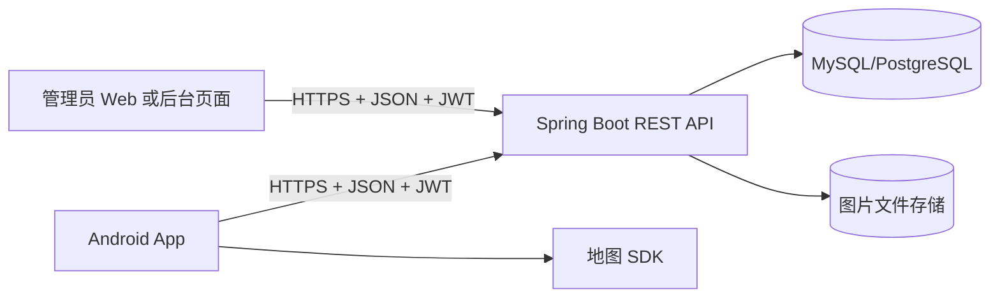

# 地标寻宝软件从零设计流程与周计划

> 适用对象：软件工程课程项目  
> 计划假设：当前课程每周一节课，共 12 周；文档前面的 16 周内容保留为完整参考，实际执行以文末“12 周最终执行版”为准。  
> 核心题目：用户到达指定地标后，拍摄自己与地标建筑的合影，完成打卡并获得一块地图碎片；收集足够碎片后，在 App 内拼接出某个区域的完整地图。

## 一、先固定项目边界

### 1. 必须完成的核心闭环

```text
注册/登录
 -> 查看地图上的地标任务
 -> 打开地标详情
 -> 到达地标附近
 -> App 内拍摄本人和地标的合影
 -> 上传照片和定位信息
 -> 后端验证打卡
 -> 获得一块地图碎片
 -> 在拼图页面解锁碎片
 -> 收集完整区域地图
```

只要这条闭环真实可运行、错误状态完整、可以现场演示，项目就达到了第一版目标。

### 2. 第一版不做的功能

以下功能容易扩大工作量，应明确排除在 MVP 之外：

- 不接入 geocaching.com，也不解析第三方网页。
- 不实现 c:geo 的多平台、多地图、GPX、Wherigo、Trackable 等功能。
- 不做实时聊天、组队、复杂社交和动态消息流。
- 不做自动人脸识别或建筑物 AI 识别。
- 不做复杂的离线地图下载。
- 不允许管理员直接修改用户的已获得碎片而不记录审计日志。

这些可以列为“未来扩展”，但不能占用核心开发周期。

## 二、需求分析

## 2.1 角色

| 角色 | 主要权限 |
|---|---|
| 普通用户 | 注册、登录、查看地标、打卡、上传合影、查看碎片和拼图进度 |
| 管理员 | 创建和维护地标任务、配置碎片、发布任务、审核异常打卡 |
| 系统 | 定位校验、照片接收、打卡记录、碎片发放、拼图进度计算 |

## 2.2 功能需求

### 用户功能

1. 用户可以注册、登录和退出。
2. 用户可以在地图上查看已发布的地标任务。
3. 用户可以查看地标名称、介绍、位置、任务说明、允许打卡时间和奖励碎片。
4. 用户可以看到自己当前位置和到地标的距离。
5. 用户进入地标允许范围后，可以打开相机拍摄合影。
6. 用户提交照片、当前位置、定位精度和任务挑战码。
7. 系统验证通过后，用户获得对应地图碎片。
8. 用户可以查看已获得、未获得和已拼接的碎片。
9. 用户可以查看自己的打卡历史和任务完成情况。

### 管理员功能

1. 管理员可以创建、编辑、发布和下架地标。
2. 管理员可以配置地标坐标、打卡半径、开放时间、任务说明和碎片位置。
3. 管理员可以查看打卡照片、定位、距离和验证结果。
4. 管理员可以审核异常打卡。
5. 管理员下架任务后，普通用户不能继续发起新的有效打卡。

## 2.3 非功能需求

- **安全性**：碎片由后端发放，客户端不能自行解锁。
- **可靠性**：网络中断时，照片和打卡草稿不能丢失。
- **可用性**：用户应能在 3 个主要页面内完成一次打卡。
- **可维护性**：地图、网络、数据库、相机和打卡业务分层。
- **可测试性**：距离校验、重复发奖、挑战码过期等规则有自动化测试。
- **隐私性**：照片只用于活动审核，限制访问权限和保存时间。

## 三、推荐技术架构

第一版建议采用“一个 Android 客户端 + 一个 REST 后端 + 一个关系数据库 + 一个图片存储”的结构。



### 3.1 Android 客户端

推荐模块：

```text
app/
  core/
    network/       Retrofit、Token、错误处理
    database/       Room、DAO、本地缓存
    location/       定位权限、位置流、距离计算辅助
    camera/         CameraX、照片压缩和临时文件
    map/            地图 SDK、Marker、地图视口
  data/
    remote/         API DTO
    local/          Room Entity
    repository/     数据来源协调
  domain/
    model/          Landmark、Task、Fragment、CheckIn
    usecase/        LoadLandmarks、SubmitCheckIn 等
  feature/
    auth/
    map/
    landmark/
    checkin/
    puzzle/
    profile/
```

数据流固定为：

```text
页面 -> ViewModel -> UseCase -> Repository -> API/Room
```

不要让页面直接调用 Retrofit，也不要把后端返回的 DTO 直接作为界面状态。

### 3.2 后端模块

```text
server/
  auth/       注册、登录、JWT、权限
  user/       用户资料
  landmark/   地标和地图范围查询
  task/       任务发布和奖励配置
  checkin/    距离、精度、挑战码和重复校验
  evidence/   照片上传和审核
  reward/     碎片发放和幂等控制
  admin/      管理员接口
```

### 3.3 地图选择

课程演示在国内校园进行时，优先选团队能够稳定申请和使用的地图 SDK。可以选择高德、腾讯或 MapLibre。第一版只选一个，不做动态切换。

必须在项目文档中明确坐标系：

- 后端统一保存一种坐标，例如 WGS-84。
- 如果地图 SDK 使用 GCJ-02，在客户端或服务端明确转换。
- 地图 Marker、GPS 原始坐标和数据库坐标不能混用而不说明。

## 四、核心业务设计

## 4.1 地标与任务

建议区分“地标”和“任务”：

- `Landmark`：真实世界中的建筑、雕塑、广场或景点。
- `TreasureTask`：围绕地标配置的一次寻宝任务。
- 一个地标可以只有一个任务，也可以在不同时间发布不同任务。

任务字段至少包括：

| 字段 | 含义 |
|---|---|
| `id` | 任务编号 |
| `landmark_id` | 关联地标 |
| `title` | 任务标题 |
| `instruction` | 合影或任务说明 |
| `latitude`、`longitude` | 地标坐标 |
| `checkin_radius_m` | 有效打卡半径 |
| `start_time`、`end_time` | 开放时间 |
| `fragment_id` | 成功后奖励的碎片 |
| `status` | 草稿、已发布、已下架 |

## 4.2 打卡验证规则

客户端可以先做一次距离提示，但最终验证必须由后端完成。

建议规则：

1. 用户必须携带有效 JWT。
2. 任务必须处于已发布状态，并且当前时间在开放范围内。
3. 后端根据用户提交坐标和任务坐标重新计算距离。
4. 距离不超过配置半径，例如 50 米或 100 米。
5. GPS 精度必须达到要求，例如 `accuracy <= 50m`。
6. 每次打卡先获取一个短期有效的一次性 `challengeNonce`。
7. 照片、Nonce、用户和任务必须对应。
8. 同一用户同一任务只能成功一次。
9. 验证通过和发放碎片必须放在同一个数据库事务中。
10. 对异常记录标记为待审核，而不是直接发奖。

第一版不要把“拍到了建筑”交给 AI 自动判断。可以要求现场合影并由管理员抽查，既可演示，也能控制实现范围。

## 4.3 拍照流程

```text
用户打开任务详情
 -> 请求定位和相机权限
 -> 获取一次性 challengeNonce
 -> 打开 App 内相机
 -> 拍摄本人和地标合影
 -> 显示预览，可重拍
 -> 压缩照片并添加时间/Nonce 水印
 -> 上传照片
 -> 提交定位、精度、照片地址和 nonce
 -> 显示“审核中”“成功”或“失败原因”
```

照片应先写入 App 私有目录，上传成功后再删除临时文件。网络失败时保存为待上传记录，由 WorkManager 重试。

## 五、拼图功能的详细设计

拼图不是简单地把几张图片横向拼接，而是一个独立的“碎片收集 + 网格解锁 + 完成判定”模块。

## 5.1 拼图模型

建议第一版使用固定网格，例如 `3 x 3` 或 `4 x 4`。

每个完整区域地图定义一个 `PuzzleMap`：

| 字段 | 含义 |
|---|---|
| `puzzle_id` | 拼图编号 |
| `name` | 区域名称 |
| `full_image_url` | 管理员上传的完整参考图，可选 |
| `rows` | 行数 |
| `columns` | 列数 |
| `total_fragments` | 碎片总数 |
| `status` | 草稿、发布、下架 |

每个 `MapFragment` 至少保存：

| 字段 | 含义 |
|---|---|
| `fragment_id` | 碎片编号 |
| `puzzle_id` | 属于哪个拼图 |
| `row_index` | 所在行，从 0 开始 |
| `column_index` | 所在列，从 0 开始 |
| `image_url` | 碎片图片地址 |
| `unlock_task_id` | 由哪个任务解锁 |
| `sort_order` | 显示顺序 |

用户获得碎片记录 `UserFragment`：

| 字段 | 含义 |
|---|---|
| `user_id` | 用户 |
| `fragment_id` | 碎片 |
| `checkin_id` | 来源打卡 |
| `obtained_at` | 获得时间 |

对 `(user_id, fragment_id)` 建唯一约束，防止重复请求重复解锁。

## 5.2 拼图页面实现

第一版不需要真的在服务器上生成一张新图片。客户端直接使用网格布局显示每个碎片：

```text
┌────────┬────────┬────────┐
│ 碎片 1 │ 未解锁 │ 碎片 3 │
├────────┼────────┼────────┤
│ 未解锁 │ 碎片 5 │ 未解锁 │
├────────┼────────┼────────┤
│ 碎片 7 │ 未解锁 │ 碎片 9 │
└────────┴────────┴────────┘
```

实现方式：

1. 后端返回 `rows`、`columns` 和用户已获得的碎片编号。
2. 客户端根据 `row_index`、`column_index` 将图片放入固定网格。
3. 未获得位置显示锁图标或半透明占位图。
4. 已获得碎片显示实际图片。
5. 完成条件是所有网格位置都已拥有。
6. 完成后显示完整地图、完成时间和分享按钮，可选。

优先使用 `GridLayout`、Compose `LazyVerticalGrid` 或等效网格组件，不要第一版手工计算图片坐标。

## 5.3 碎片来源设计

为了让演示可控，建议第一版采用“一任务对应一碎片”：

```text
地标 A -> 任务 A -> 碎片 (0, 0)
地标 B -> 任务 B -> 碎片 (0, 1)
地标 C -> 任务 C -> 碎片 (0, 2)
...
```

不要第一版随机掉落碎片，否则用户可能多次完成任务仍无法拼完整地图，现场演示难以控制。

后续可以扩展：

- 重复碎片兑换积分。
- 多张区域地图。
- 任务难度对应不同碎片。
- 组队共享拼图。
- 碎片顺序提示或线索。

## 5.4 拼图接口

建议接口：

```text
GET  /api/v1/puzzles
GET  /api/v1/puzzles/{puzzleId}
GET  /api/v1/puzzles/{puzzleId}/progress
GET  /api/v1/me/fragments
```

打卡成功时，后端一次性返回：

```json
{
  "checkinId": 1001,
  "status": "APPROVED",
  "newFragment": {
    "fragmentId": 5,
    "puzzleId": 1,
    "row": 1,
    "column": 1,
    "imageUrl": "/files/puzzles/1/fragment-5.jpg"
  },
  "progress": {
    "owned": 5,
    "total": 9,
    "completed": false
  }
}
```

这样客户端不需要自行推断奖励，也不会出现“打卡成功但拼图没有刷新”的状态不一致。

## 六、主要页面和用户流程

| 页面 | 主要内容 | 验收标准 |
|---|---|---|
| 登录页 | 用户名、密码、登录按钮 | 登录成功进入地图，错误显示原因 |
| 地图页 | 当前定位、地标 Marker、任务状态 | 能加载至少 5 个测试地标 |
| 地标详情页 | 图片、介绍、距离、任务说明、奖励 | 能打开打卡入口 |
| 打卡页 | 定位状态、相机预览、重拍、提交 | 能拍照并提交 |
| 结果页 | 成功、审核中、失败原因 | 状态明确，不重复提交 |
| 拼图页 | 网格、锁定状态、进度 | 成功打卡后对应位置解锁 |
| 个人中心 | 历史、碎片数、完成度、退出 | 数据与后端一致 |
| 管理页 | 地标、任务、碎片、审核 | 管理员可以配置演示数据 |

## 七、16 周工作周期

每周一节课时，不应把一周目标写成“完成一大堆代码”。每周必须有一个可展示的产物和一个可验收的结果。

### 第 1 周：理解题目与确定范围

**课堂目标**

- 明确用户、管理员、系统三个角色。
- 将图片中的题目要求转成用户故事。
- 决定第一版只实现“校园区域地图 + 固定碎片 + 单次打卡”。

**产物**

- 项目背景和目标。
- 功能列表和非功能需求。
- MVP 边界。
- 初步风险清单。

**验收**

所有成员能用一句话说明核心闭环：到达地标、拍合影、获得碎片、拼完整地图。

### 第 2 周：用例与业务流程

**课堂目标**

- 绘制普通用户和管理员用例图。
- 绘制“用户打卡”和“管理员审核”两个活动图。
- 明确成功、失败、审核中、重复提交、网络失败等状态。

**产物**

- 用例图。
- 用户打卡活动图。
- 管理员审核活动图。
- 状态转换表。

**验收**

每一个核心功能都能回答：谁发起、输入是什么、系统处理什么、输出是什么、失败怎么办。

### 第 3 周：原型与交互设计

**课堂目标**

- 设计登录、地图、详情、打卡、结果、拼图、个人中心页面。
- 重点确定拼图页面的网格布局和未解锁状态。
- 确定现场演示路径。

**产物**

- 页面原型或高保真界面图。
- 页面跳转图。
- 拼图交互原型。

**验收**

不写后端、不依赖真实地图，也能用原型走完一次完整打卡流程。

### 第 4 周：总体架构与技术选型

**课堂目标**

- 确定 Android 技术栈、后端技术栈、数据库和地图 SDK。
- 确定前后端分层和团队代码目录。
- 确定坐标系、图片存储方式和鉴权方式。

**产物**

- 系统总体架构图。
- 部署图。
- 技术选型表。
- Git 分支和代码规范。

**验收**

能够解释为什么客户端不能直接决定“获得碎片”，以及地图、照片和业务数据分别存在哪里。

### 第 5 周：数据库与接口设计

**课堂目标**

- 设计 `users`、`landmarks`、`treasure_tasks`、`puzzles`、`map_fragments`、`checkins`、`user_fragments`。
- 设计 REST API 和错误码。
- 处理重复打卡和重复发奖的唯一约束。

**产物**

- ER 图。
- 数据库建表脚本或迁移文件。
- OpenAPI 初稿。
- JSON 请求/响应示例。

**验收**

从数据库和接口设计可以完整表达：一个任务奖励哪一个拼图位置，以及哪个用户通过哪次打卡获得该碎片。

### 第 6 周：项目骨架与环境打通

**课堂目标**

- 创建 Android 工程和后端工程。
- 配置数据库、基础日志、统一响应格式和异常处理。
- 打通 Android 调用后端的测试接口。

**产物**

- Android 空白 App 可以启动。
- 后端可以启动并返回健康检查接口。
- 数据库可以连接。
- 第一个 API 在真机或模拟器中调用成功。

**验收**

完成“客户端请求 `/health`，后端返回成功”的最小联调。

### 第 7 周：用户认证与权限

**课堂目标**

- 完成注册、登录、退出。
- 实现 JWT 或等效 Token 机制。
- 区分普通用户和管理员。

**产物**

- 用户表和认证接口。
- Android 登录页。
- Token 保存、过期和错误处理。
- 管理员接口的权限拦截。

**验收**

普通用户不能访问管理员接口；登录失败有明确提示；重新打开 App 后可以正确判断登录状态。

### 第 8 周：地标和任务管理

**课堂目标**

- 后端完成地标和任务的增删改查。
- 管理员能够配置坐标、半径、开放时间和奖励碎片。
- 客户端完成地标列表和详情数据展示。

**产物**

- 至少 5 个真实或模拟校园地标。
- 地标管理接口或简单管理页面。
- 地标详情页面。

**验收**

管理员发布一个任务后，普通用户可以查询到该任务并看到奖励碎片位置。

### 第 9 周：地图与定位

**课堂目标**

- 集成地图 SDK。
- 显示当前位置和地标 Marker。
- 计算用户到地标的距离。
- 增加定位权限拒绝和 GPS 关闭处理。

**产物**

- 可运行地图页。
- 当前定位 Marker。
- 至少 5 个地标 Marker。
- 距离和“未到达/可以打卡”状态。

**验收**

在校园内移动时，地图能刷新当前位置；点击 Marker 能进入地标详情；地图移动不会无限制重复请求。

### 第 10 周：相机与照片上传

**课堂目标**

- 集成 CameraX 或等效相机能力。
- 完成拍摄、预览、重拍和压缩。
- 完成照片上传接口。
- 保存上传失败的临时文件。

**产物**

- 打卡拍照页。
- 图片上传接口。
- 图片存储路径和访问策略。
- 大图片压缩方案。

**验收**

用户可以在 App 内拍照，服务器可以收到照片，客户端不会因为拍摄一张大图而崩溃。

### 第 11 周：打卡验证与挑战码

**课堂目标**

- 实现短时一次性挑战码。
- 后端重新计算距离和验证 GPS 精度。
- 实现打卡记录和状态。
- 处理重复提交、超出范围、任务关闭和网络失败。

**产物**

- `/checkin-challenge` 接口。
- `/checkins` 接口。
- 打卡结果页。
- 失败原因枚举。

**验收**

至少验证以下情况：范围内成功、范围外失败、挑战码过期失败、同一任务重复打卡失败、普通用户越权失败。

### 第 12 周：碎片发放与拼图基础

**课堂目标**

- 建立拼图、碎片和用户碎片数据。
- 打卡成功后事务性发放碎片。
- 客户端显示固定网格。
- 未获得碎片显示锁定占位。

**产物**

- 拼图配置接口。
- 用户拼图进度接口。
- 拼图页面第一版。
- 打卡成功后自动解锁对应格子。

**验收**

完成一个任务后，正确的网格位置解锁；重复请求不会重复产生碎片；刷新页面后状态仍然正确。

### 第 13 周：完整地图和离线失败恢复

**课堂目标**

- 完成 3 x 3 或 4 x 4 拼图。
- 所有碎片收集后显示完整地图。
- 增加打卡失败重试和本地待上传记录。
- 增加加载、空状态和错误状态。

**产物**

- 可完整拼图的测试数据。
- 完整地图展示页。
- WorkManager 或等效重试机制。
- 网络异常提示。

**验收**

断网后用户不会丢失已拍照片；恢复网络后可以继续上传；拼图缺片、完成和加载中状态都正确显示。

### 第 14 周：管理端和审核流程

**课堂目标**

- 完成管理员查看打卡记录和照片。
- 支持通过、拒绝和填写拒绝原因。
- 处理审核模式下的碎片发放时机。

**产物**

- 待审核列表。
- 打卡详情和照片查看。
- 审核通过/拒绝接口。
- 审核日志或操作记录。

**验收**

如果采用自动审核，管理员可以查看记录并撤销；如果采用人工审核，打卡必须在审核通过后才发放碎片。

### 第 15 周：系统测试与现场测试

**课堂目标**

- 按测试用例逐项执行。
- 真机测试定位、相机、地图、上传、拼图。
- 测试多人同时操作和重复请求。
- 修复高优先级缺陷。

**产物**

- 测试计划。
- 测试用例和执行结果。
- 缺陷清单。
- 修复记录。

**必须测试**

- 定位权限拒绝。
- GPS 关闭或定位精度差。
- 范围边界，例如 49 米成功、51 米失败。
- 网络中断和上传失败。
- 挑战码过期和重复使用。
- 重复提交不重复发奖。
- 普通用户访问管理员接口。
- 拼图数据缺失或图片加载失败。

### 第 16 周：部署、汇报和演示

**课堂目标**

- 部署后端、数据库和图片存储。
- 准备演示账号、演示地标和演示拼图。
- 完成项目文档、PPT 和答辩流程。

**产物**

- 可安装 APK 或可运行客户端。
- 可访问的后端服务。
- 项目说明书。
- 用户手册、接口文档、测试报告。
- 演示视频或现场演示脚本。

**建议演示顺序**

1. 管理员发布 3～9 个地标任务。
2. 普通用户登录并打开地图。
3. 点击地标查看任务和距离。
4. 模拟或现场到达指定范围。
5. App 内拍照并提交。
6. 展示后端验证结果。
7. 返回拼图页面，展示一个格子解锁。
8. 连续完成多个任务，展示完整地图。
9. 故意提交一次范围外或重复打卡，展示失败处理。

## 八、如果课程只有 12 周

压缩原则是：保留核心闭环，合并设计周，取消复杂管理端和离线重试。

| 周次 | 合并内容 |
|---|---|
| 第 1 周 | 需求、用例、MVP 范围 |
| 第 2 周 | 原型、架构、数据库和接口 |
| 第 3 周 | 项目骨架、数据库、认证 |
| 第 4 周 | 地标和任务管理 |
| 第 5 周 | 地图和定位 |
| 第 6 周 | 相机、照片上传 |
| 第 7 周 | 距离验证、挑战码、打卡 |
| 第 8 周 | 碎片、拼图数据模型 |
| 第 9 周 | 拼图界面和完成判定 |
| 第 10 周 | 基础错误处理和管理员审核 |
| 第 11 周 | 全面测试和修复 |
| 第 12 周 | 部署、文档、答辩演示 |

12 周版本应明确删除：排行榜、复杂离线队列、多人组队、自动识别和完整管理后台。管理员可以直接使用数据库脚本或简单接口配置演示任务。

## 九、团队分工建议

以 5 人团队为例：

| 成员 | 负责模块 | 主要交付物 |
|---|---|---|
| A | Android 地图与定位 | 地图页、Marker、距离、权限处理 |
| B | Android 相机与拼图 | CameraX、上传界面、拼图网格、个人中心 |
| C | 后端认证与地标 | 用户、JWT、角色、地标、任务 API |
| D | 后端打卡与奖励 | 距离验证、挑战码、打卡、碎片事务 |
| E | 管理端、测试和部署 | 任务配置、审核、测试、文档、部署 |

每周课后都要进行一次接口联调。不能等到最后两周才把 Android 和后端合并。

## 十、每周固定工作机制

每周课程可以固定采用以下节奏：

### 课前

- 每个人完成上周任务并提交代码。
- 负责人整理本周遇到的问题。
- 更新任务看板和缺陷列表。

### 课堂

1. 10 分钟：检查上周验收结果。
2. 20 分钟：讲解本周设计和风险。
3. 40 分钟：分组开发或联调。
4. 20 分钟：现场展示本周产物。
5. 10 分钟：确定下周任务和负责人。

### 课后

- 合并代码并打标签，例如 `week-08`。
- 更新接口文档、数据库设计和测试记录。
- 至少保留一个可运行版本，避免只剩下未完成分支。

## 十一、项目验收标准

### P0：必须通过

- 用户可以登录。
- 地图可以显示地标。
- 可以打开地标任务详情。
- 可以拍照并上传。
- 后端可以验证位置和任务状态。
- 打卡成功后获得正确碎片。
- 拼图页面显示已获得碎片。
- 收集全部碎片后显示完整地图。
- 重复打卡不会重复发奖。

### P1：建议完成

- 管理员可以发布任务和审核记录。
- 网络失败时显示清晰原因。
- 图片上传失败可以重试。
- 有 Room 缓存或最基本的离线草稿。
- 有自动化接口测试和核心业务单元测试。

### P2：可作为加分项

- 排行榜。
- 组队寻宝。
- 多张区域地图。
- 重复碎片兑换积分。
- 分享完整地图。
- 任务线索和难度等级。

## 十二、主要风险和应对

| 风险 | 影响 | 应对方案 |
|---|---|---|
| GPS 在建筑附近漂移 | 合法用户无法打卡 | 半径适当放宽，显示精度，允许人工审核 |
| 地图 SDK Key 申请或配额问题 | 地图无法演示 | 第 4 周完成申请，准备静态地图/备用 SDK |
| 图片上传慢 | 打卡流程中断 | 压缩图片，限制大小，保存待上传记录 |
| 任务和碎片数据不一致 | 拼图错误 | 数据库外键、唯一约束和事务发奖 |
| 多人不会后端或 Android | 联调延期 | 第 6 周完成最小端到端接口，不晚于第 8 周联调 |
| 功能范围膨胀 | 核心闭环无法完成 | P0/P1/P2 分级，P2 只能在 P0 稳定后开发 |
| 现场网络不稳定 | 演示失败 | 准备演示账号、缓存数据、预录视频和备用网络 |

## 十三、最终推荐路线

项目最稳妥的实现顺序是：

```text
需求和原型
 -> 数据库和接口
 -> 登录
 -> 地标和地图
 -> 定位
 -> 相机和照片
 -> 后端打卡校验
 -> 碎片事务发放
 -> 拼图网格
 -> 管理审核
 -> 测试部署
```

最关键的设计决定有三个：

1. **后端决定是否成功和是否发碎片，客户端只负责采集和展示。**
2. **拼图使用固定网格和 `row/column` 坐标，第一版不做随机掉落。**
3. **每周都要有可运行、可演示、可验收的版本，不把联调和测试全部留到最后。**

按这个节奏，16 周结束时应能完成一个范围明确、业务闭环完整、具有前后端分层和拼图特色的课程项目，而不是一个功能很多但无法稳定演示的半成品。

## 十四、模块化迭代方案：先离线闭环，再接入联网

你提出的“先做地图，再叠加地标，再完善离线版本，最后接入联网接口”的思路是合理的，优点是每个阶段都有明确的可运行成果，出现问题时更容易定位。

但不建议完全按照“所有本地功能做完以后，最后才考虑后端”的方式开发。原因是：

- 本地数据结构可能和后端数据结构不一致。
- 本地打卡逻辑可能没有考虑服务器验证和审核状态。
- 照片上传、Token、网络失败重试等问题会集中在最后爆发。
- 地图 SDK、定位权限和后端坐标系如果后期才联调，返工成本很高。

因此推荐采用：

```text
基础模块
 -> Mock 数据接口
 -> 本地离线垂直闭环
 -> 真实后端只读接入
 -> 真实打卡和照片上传
 -> 离线同步与异常处理
 -> 综合测试和发布
```

也就是说，后端可以晚一点实现，但接口契约不能晚一点设计；地图可以先用假数据，但数据访问接口不能直接写死在页面中。

### 14.1 推荐的模块边界

#### A. 地图基础模块

只负责地图能力，不负责地标业务：

- 初始化地图 SDK。
- 显示地图和缩放控制。
- 获取和显示当前位置。
- 处理定位权限和 GPS 状态。
- 显示通用 Marker。
- 响应地图移动和缩放。
- 提供地图视口 `Viewport`。

地图模块不应该直接请求后端，也不应该直接查询数据库。它只接收一个 Marker 列表和一个当前位置。

#### B. 地标模块

负责把业务对象显示到地图上：

- 地标数据模型。
- 地标 Marker 图标和状态。
- 地标详情页。
- 距离计算和到达状态。
- 地标筛选。

地标模块通过 `LandmarkRepository` 获取数据，不关心数据来自 Mock、Room 还是服务器。

#### C. 本地数据模块

负责离线存储：

- Room 数据库。
- 地标、任务、拼图、碎片和打卡草稿表。
- 本地查询和更新。
- 初始化演示数据。
- 数据库版本迁移。

#### D. 打卡模块

负责用户完成任务：

- 检查当前位置和定位精度。
- 获取相机权限。
- 拍照、预览、重拍和压缩。
- 保存本地照片。
- 保存打卡草稿。
- 展示成功、失败、审核中和待上传状态。

第一阶段可以使用本地规则模拟验证，后续把验证实现替换成服务器调用。

#### E. 拼图模块

负责碎片和地图拼接：

- 拼图网格显示。
- 已获得/未获得状态。
- 碎片图片加载。
- 进度计算。
- 完整地图展示。
- 重复碎片和数据缺失处理。

拼图模块不负责判断用户是否有资格获得碎片，它只接收 `UserFragment` 数据并显示结果。

#### F. 网络模块

负责通用联网能力：

- Retrofit/OkHttp。
- Token 添加和刷新。
- 统一错误处理。
- 请求超时和重试。
- 图片上传。
- API 日志。

网络模块不能把业务判断写在 HTTP 工具类中，业务规则应放在 Repository 或 UseCase 中。

#### G. 同步模块

最后单独处理离线和联网数据同步：

- 本地待上传打卡队列。
- 网络恢复检测。
- WorkManager 重试。
- 上传成功后更新本地状态。
- 服务端拒绝后的错误记录。
- 防止重复上传和重复发奖。

## 十五、推荐的分阶段工作链

### 阶段 0：定义接口和最小骨架

**目标**：先把模块之间的边界固定下来，避免后期互相调用混乱。

```text
MapScreen
  -> LandmarkViewModel
  -> LandmarkRepository
  -> LandmarkDataSource
```

`LandmarkDataSource` 先定义接口，第一版实现 `MockLandmarkDataSource`，以后再增加 `LocalLandmarkDataSource` 和 `RemoteLandmarkDataSource`。

建议提前定义的接口：

```kotlin
interface LandmarkRepository {
    suspend fun getLandmarks(viewport: Viewport): Result<List<Landmark>>
    suspend fun getLandmark(id: Long): Result<Landmark>
}

interface CheckInRepository {
    suspend fun submitLocalCheckIn(request: LocalCheckInRequest): Result<CheckIn>
    suspend fun submitRemoteCheckIn(request: RemoteCheckInRequest): Result<CheckIn>
}

interface PuzzleRepository {
    suspend fun getProgress(puzzleId: Long): Result<PuzzleProgress>
}
```

实际项目不一定要完全照抄这些接口，但应保持“界面不直接依赖具体数据库或 HTTP 实现”。

### 阶段 1：地图壳和定位基础

**先做**：地图 SDK、定位、权限、Marker、视口。

**暂时不做**：真实地标接口、照片、登录、后端。

使用固定的 Mock Marker，例如校园内 5 个坐标点，验证地图基础能力。

**可测试成果**：

- App 能启动并显示地图。
- 能请求和处理定位权限。
- 能显示当前位置。
- 能显示 5 个 Mock Marker。
- 地图移动和缩放不会崩溃。
- 无定位权限时有明确空状态。

**阶段出口**：地图模块可以被单独演示，且不依赖后端。

### 阶段 2：地标显示和详情

**叠加模块**：地标模型、地标 Marker、详情页面、距离显示。

Mock 数据示例：

```json
{
  "id": 1,
  "name": "校园钟楼",
  "latitude": 31.123456,
  "longitude": 121.123456,
  "description": "校园地标介绍",
  "checkinRadiusMeters": 80,
  "taskId": 101
}
```

**可测试成果**：

- 点击 Marker 进入地标详情。
- 详情显示名称、图片、介绍、距离和任务状态。
- 地图和详情页使用同一份地标数据。
- 能区分未开始、未到达、可以打卡和已完成。

**阶段出口**：地图已经具有地理寻宝的基本形态，但数据仍来自 Mock。

### 阶段 3：本地数据库和离线地标

**替换方式**：用 Room 替代内存 Mock，但暂时不联网。

建议顺序：

1. 建立 `LandmarkEntity`、`TaskEntity`、`PuzzleEntity`、`FragmentEntity`。
2. 编写 DAO 查询。
3. 写入校园演示数据。
4. Repository 优先查询 Room。
5. 地图和详情改为观察本地数据。

**可测试成果**：

- 杀掉 App 后重新打开，地标仍然存在。
- 地图无网络时仍能打开和显示地标。
- 地标详情和地图显示内容一致。
- 数据库升级不会导致崩溃。

**阶段出口**：得到一个真正可离线运行的“地图 + 地标浏览”版本。

### 阶段 4：本地打卡模拟

这一阶段先不接服务器，重点验证打卡状态机。

```text
LOCKED
 -> OUT_OF_RANGE
 -> READY
 -> PHOTO_CAPTURED
 -> SUBMITTING_LOCAL
 -> APPROVED_LOCAL / REJECTED_LOCAL
 -> FRAGMENT_GRANTED
```

实现内容：

- 位置范围判断。
- GPS 精度提示。
- CameraX 拍照、预览和重拍。
- 照片保存到本地目录。
- 本地生成打卡记录。
- 本地模拟验证通过或失败。

为了便于测试，可以在开发模式提供“模拟当前位置”或“模拟验证通过”按钮，但必须只在 Debug 构建中启用，不能进入最终演示版本。

**可测试成果**：

- 范围外不能提交。
- 范围内可以拍照。
- 拍照失败、取消和重拍流程正确。
- 本地成功后可以产生一条打卡记录。
- 失败原因明确。

**阶段出口**：完全断网时，也能演示从地图到拍照再到本地打卡结果。

### 阶段 5：本地拼图闭环

这是第一个完整的离线垂直切片：

```text
本地地标
 -> 本地拍照打卡
 -> 本地验证通过
 -> 本地获得固定碎片
 -> 本地拼图解锁
```

实现内容：

- 配置 3 x 3 或 4 x 4 拼图。
- 每个任务固定对应一个碎片坐标。
- 打卡成功后更新 `UserFragment`。
- 拼图页面显示网格、锁定和已解锁状态。
- 所有格子解锁后显示完整地图。

**可测试成果**：

- 每个任务解锁正确的格子。
- 重复打卡不会重复发放碎片。
- App 重启后拼图进度保留。
- 缺片时不会错误显示完整地图。
- 所有碎片拥有后，完成状态正确。

**阶段出口**：形成一个不依赖网络的完整演示版本。这是整个项目最重要的保底版本。

### 阶段 6：后端基础和只读联网

后端不要一开始就接管全部功能，先接入最容易验证的只读接口：

1. 后端健康检查。
2. 登录和 Token。
3. 获取地标列表。
4. 获取任务详情。
5. 获取拼图配置。
6. 获取用户碎片进度。

客户端先实现：

```text
RemoteDataSource -> Repository -> Room 缓存 -> 页面
```

推荐策略：

```text
先读 Room
 -> 有缓存立即显示
 -> 后台请求服务器
 -> 成功后更新 Room
 -> 页面自动刷新
```

**可测试成果**：

- 服务器地标可以显示在地图上。
- 后端修改地标名称后，客户端刷新可以看到变化。
- 断网时仍显示上次缓存。
- Token 过期时能回到登录页或刷新 Token。

**阶段出口**：完成从本地数据到真实后端数据的平滑替换，而不是直接重写页面。

### 阶段 7：联网打卡和照片上传

在本地打卡闭环已经稳定后，再替换打卡实现：

```text
本地拍照
 -> 获取服务器 challengeNonce
 -> 上传照片
 -> 提交坐标、精度、nonce 和照片地址
 -> 后端校验
 -> 事务性发放碎片
 -> 返回最新拼图进度
 -> 更新 Room
```

需要增加的状态：

- `DRAFT`：已拍照但未提交。
- `UPLOADING`：照片上传中。
- `PENDING_REVIEW`：等待审核。
- `APPROVED`：成功并已发碎片。
- `REJECTED`：后端拒绝。
- `RETRY_REQUIRED`：网络或服务暂时失败。

**可测试成果**：

- 范围内真实打卡成功并解锁碎片。
- 范围外真实打卡被后端拒绝。
- 同一请求重复发送不会重复发奖。
- 照片上传成功但提交失败时可以重试。
- 服务端返回的碎片和客户端网格位置一致。

### 阶段 8：管理端和任务配置

联网打卡稳定后再完善管理员能力：

- 创建和编辑地标。
- 创建和编辑任务。
- 配置碎片网格位置。
- 发布和下架任务。
- 查看照片和定位信息。
- 审核待处理打卡。

管理端不必一开始做成完整 Web 系统。课程项目可以先做一个简单的后台页面，甚至使用受权限保护的接口和初始化脚本；但必须保留管理员权限校验。

**阶段出口**：不修改数据库脚本也能配置一组新的演示任务。

### 阶段 9：同步、异常和综合质量

最后处理跨模块问题：

- 无网时保存待上传打卡。
- 网络恢复后自动重试。
- 上传成功后清理本地临时照片。
- 服务端拒绝后保留失败原因。
- 同步过程中禁止重复创建打卡。
- Room 和服务器数据冲突时以服务器状态为准。
- 统一处理空数据、加载中、网络错误和权限错误。

**阶段出口**：弱网、断网、重复点击和 App 重启不会破坏数据状态。

## 十六、按模块划分的测试策略

模块化的关键不是把代码分成很多文件，而是每个模块都能独立验证。

### 地图模块测试

- 地图初始化成功。
- Marker 数量和坐标正确。
- 地图移动不导致内存泄漏或无限请求。
- 定位权限拒绝时显示提示。
- 地图 SDK 不可用时显示降级页面。

### 地标模块测试

- 地标详情和 Marker 使用相同 ID。
- 距离计算输入和结果正确。
- 地标状态转换正确。
- 不同视口只显示范围内数据。

### 本地数据库测试

- 地标插入、更新、删除。
- App 重启后数据保留。
- 数据库迁移成功。
- 唯一约束阻止重复碎片。

### 打卡模块测试

- 范围内和范围外。
- 定位精度不足。
- 相机取消、重拍和上传失败。
- 打卡状态不能非法跳转。

### 拼图模块测试

- `row/column` 映射正确。
- 缺片位置显示锁定。
- 已获得碎片显示正确图片。
- 所有碎片齐全后才显示完成。
- 重复碎片不会破坏进度。

### 联网和同步测试

- Token 过期。
- 网络超时。
- 重复请求。
- 上传中断。
- 服务端拒绝。
- 断网后恢复。

## 十七、重新安排后的 16 周计划

相较于前面的“按功能直接推进”计划，建议调整为以下模块化工作链：

| 周次 | 阶段 | 本周重点 | 周末必须具备的版本 |
|---|---|---|---|
| 1 | 接口骨架 | 需求、模块边界、数据模型、Mock 接口 | 能启动的空 App 和后端骨架 |
| 2 | 地图基础 | 地图 SDK、权限、当前位置、Marker | 地图 + 当前定位 + Mock 点 |
| 3 | 地图基础 | 视口、地图状态、错误和空状态 | 可独立测试的地图模块 |
| 4 | 地标模块 | 地标详情、距离、任务状态 | 地图点可打开详情 |
| 5 | 本地数据 | Room、Entity、DAO、演示数据 | 断网可显示地标和详情 |
| 6 | 本地打卡 | 范围判断、定位状态、状态机 | 可模拟本地打卡 |
| 7 | 相机模块 | CameraX、预览、重拍、压缩 | 可保存本地合影 |
| 8 | 离线闭环 | 本地打卡、碎片和拼图 | 断网完成一次完整寻宝 |
| 9 | 后端只读 | 登录、地标、任务、拼图 API | 客户端读取真实服务器数据 |
| 10 | 网络缓存 | RemoteDataSource、Room 缓存、错误处理 | 有网刷新、断网可看缓存 |
| 11 | 联网打卡 | nonce、照片上传、后端距离校验 | 真实打卡成功或拒绝 |
| 12 | 远程碎片 | 事务发奖、拼图进度同步 | 真实打卡解锁远程碎片 |
| 13 | 管理功能 | 地标、任务、碎片配置 | 可配置新的演示任务 |
| 14 | 同步异常 | 待上传队列、重试、重复请求保护 | 弱网和断网可恢复 |
| 15 | 综合测试 | 真机、现场、多人和异常场景 | 缺陷清单和修复版本 |
| 16 | 部署答辩 | 部署、文档、演示、视频 | 可稳定展示的最终版本 |

## 十八、每个阶段的进入和退出条件

为了避免“模块做了一半就往后推进”，每个阶段设置质量门禁。

### 进入条件

- 上一阶段核心测试通过。
- 模块接口已经确定。
- 已知高优先级缺陷有负责人。
- 演示数据可以重新初始化。

### 退出条件

- 有可安装或可启动版本。
- 至少有一个正常流程和两个异常流程通过。
- 代码已经合并到主分支。
- 使用说明和测试记录已经更新。
- 下一模块不需要直接修改上一模块内部实现。

## 十九、对“先地图、后联网”方案的最终判断

这个方向比一开始就同时开发地图、登录、相机、后端和拼图更稳，但需要做三点调整：

1. **地图先做，但使用 Mock Repository，不要把假数据写死在地图页面中。**
2. **离线闭环先做，但从第一天就保留服务器状态字段，例如 `PENDING_REVIEW`、`APPROVED` 和 `RETRY_REQUIRED`。**
3. **联网最后接入，但第 1～5 周就定义好 API、数据模型和坐标规则。**

推荐的保底版本是第 8 周完成的离线完整闭环：

```text
离线地图
 -> 离线地标
 -> 离线定位判断
 -> 本地拍照
 -> 本地打卡记录
 -> 本地获得固定碎片
 -> 本地拼图完成
```

如果第 8 周已经有这个版本，即使后端接入出现问题，课程项目仍然有可展示成果；第 9 周以后是在这个稳定基础上逐步替换数据来源和验证方式，而不是重新开发整个应用。

## 二十、五人并行开发的总体组织方式

前面的阶段链解决了“先做什么、后做什么”的问题，但五个人不应该完全串行等待。更适合的组织方式是：

```text
产品/需求/UX 流
        \                 /-> Android 地图与基础界面
         -> 接口契约和数据模型
        /                 \-> 后端服务和数据库
测试/质量/部署流  <------->  打卡、拼图和同步模块
```

所有工作流共享三个东西：

1. **统一的数据模型**：地标、任务、打卡、碎片、拼图。
2. **统一的 API 契约**：请求字段、响应字段、错误码、状态枚举。
3. **统一的验收标准**：每周必须有可运行版本和测试记录。

## 20.1 双人小组基础上的动态编组

固定双人小组有利于互相监督，但不能把五个人永久锁定在两条流水线上。更合理的方式是按照任务难度动态切换三种模式：

```text
简单任务：1 人 1 项，并行分流
中等任务：2 人结对开发和 Review
复杂任务：全员围绕一个问题合流
```

双人小组只是默认协作关系，不是固定部门。每周根据任务拆分结果重新编组，确保每个人都有明确的工作量，同时避免复杂模块被一个人独自承担。

推荐的基础搭档仍然是：

- 小组 1：A+B，偏产品体验、UI/UX、Android、地图和页面。
- 小组 2：C+D，偏后端、数据库、API、打卡和拼图。
- E：动态加入当前最需要帮助的小组，同时承担集成、测试、素材、部署和文档任务。

但是在简单任务较多的周，可以拆成 A、B、C、D、E 五个独立任务；在地图、联网打卡、事务发奖等复杂周，则由全员共同解决。

### 小组 1：产品体验与客户端小组

建议成员 A、B，负责：

- 需求、用户故事、用例和页面流程。
- UI/UX、线框图、高保真界面和设计规范。
- Android 工程、页面导航和主题。
- 地图 SDK、定位权限、当前位置和 Marker。
- 地标列表、详情页、个人中心。
- ViewModel、Repository 接口和 Room 缓存接入。
- 空状态、加载状态、错误提示和权限引导。

A 侧重需求和 UI/UX，B 侧重 Android 和地图，但两人共同负责客户端最终质量。A 不能只交设计稿，B 不能只按自己的理解写界面；每个页面都要经过“设计说明 + 真机检查”。

### 小组 2：后端业务与打卡拼图小组

建议成员 C、D，负责：

- 用户、角色、JWT 和权限。
- 地标、任务、拼图、碎片和打卡数据库。
- OpenAPI、错误码和测试数据。
- CameraX 拍照、照片压缩和本地临时文件。
- 打卡状态机和离线草稿。
- 挑战码、距离、精度、重复提交校验。
- 事务性发放碎片。
- 拼图网格、碎片解锁和完整地图。

C 侧重 Android 打卡、相机和拼图，D 侧重后端、数据库和 API，但两人必须共同理解“打卡成功如何产生碎片”的完整数据链路。

### 第 5 人：轮值集成与质量负责人

成员 E 不固定成为“测试人员”，而是按阶段轮流加入两个小组：

| 阶段 | E 的主要搭档 | 重点 |
|---|---|---|
| 第 1～4 周 | 小组 1 | 需求验收、原型检查、地图冒烟测试 |
| 第 5～8 周 | 小组 2 | 数据库、离线打卡、拼图回归测试 |
| 第 9～12 周 | 两个小组交替 | API 联调、真实打卡和缓存测试 |
| 第 13～16 周 | 全组 | 管理端、现场测试、部署和答辩 |

E 的固定职责仍然包括：

- 维护测试计划、缺陷列表和版本标签。
- 维护 Mock 数据、Postman 集合和测试账号。
- 组织每周集成和验收。
- 检查 Debug、Staging、Demo 环境。
- 维护部署说明、演示脚本和应急方案。

## 20.2 何时两人协作，何时全员协作

### 双人协作任务

以下任务适合由一对成员共同完成：

- 一个页面的设计和实现。
- 一个 API 的设计、实现和测试。
- 一个 Room Entity、DAO 和 Repository。
- 一个打卡状态流转。
- 一个拼图组件和进度接口。
- 一个错误场景和对应 UI。

双人协作时采用“Driver + Navigator”方式：一人操作电脑实现，另一人实时检查设计、边界和代码；每 30～60 分钟交换角色。

### 全员协作任务

以下任务不适合由某一组独立决定：

- 第 1～2 周的需求、数据模型和 API 契约。
- 第 8 周的离线完整闭环。
- 第 11～12 周的真实联网打卡、照片上传和事务发奖。
- 第 15～16 周的现场测试、部署和答辩。

全员协作不是五个人挤在一台电脑前，而是：

1. 共同确认流程和接口。
2. 两人负责主实现。
3. 另外三人分别做测试、边界检查和文档记录。
4. 全员共同进行版本验收。

### 责任交叉规则

- 每个核心功能必须有两名成员理解和维护。
- 小组 1 不得私自修改 API 字段，小组 2 不得私自改变界面状态含义。
- API、数据库、状态枚举和 P0 需求变更必须全员确认。
- 每次合并请求至少由搭档和另一小组各审查一次。
- E 组织测试，但测试用例由实现小组共同编写，避免“测试人员不了解业务”。
- 关键功能必须保留录屏或截图作为验收证据。

## 20.3 双人小组协作矩阵

| 周次 | 小组 1：A+B | 小组 2：C+D | E 的位置 | 协作模式 |
|---|---|---|---|---|
| 1 | 需求、页面流程、Android 骨架 | 业务模型、后端骨架、状态机 | 参与共同契约和看板 | 全员启动 |
| 2 | 页面线框、Repository 接口 | ER 图、OpenAPI、Mock 接口 | Mock 数据和测试模板 | 全员定契约 |
| 3 | 地图 SDK、主题和设计规范 | 数据库脚本、打卡/拼图静态模型 | 加入小组 1 做冒烟测试 | 分流 + 结对 |
| 4 | Mock Marker、地标详情、距离 | Mock API、任务数据 | 加入小组 1 做地图验收 | 结对 + 交叉验收 |
| 5 | Room、地标缓存、详情页 | 任务/碎片本地模型、后端只读表 | 加入小组 2 做数据库测试 | 分流 + 结对 |
| 6 | 定位状态和地图入口 | 本地打卡状态机、后端距离测试 | 加入小组 2 做规则测试 | 结对 + 短时合流 |
| 7 | 相机页面的导航和权限配合 | CameraX、照片、临时文件、上传草稿 | 加入小组 2 做真机测试 | 结对开发 |
| 8 | 地图到打卡的页面串联 | 本地验证、碎片发放、拼图 | 全员共同验收 | 全员合流 |
| 9 | 登录页、Token、远程数据接入 | JWT、地标/任务/拼图 API | 负责认证和联调测试 | 分流 + 结对 |
| 10 | Room 缓存、刷新和错误状态 | 地图视口查询、分页、接口稳定性 | 加入两组做断网测试 | 分流 + 交叉 Review |
| 11 | 真实任务详情和打卡入口 | nonce、距离、精度、照片上传 API | 组织真机和 Postman 联调 | 结对 + 短时合流 |
| 12 | 远程结果刷新和拼图 UI | 事务发奖、幂等和唯一约束 | 全员测试重复/并发提交 | 全员合流 |
| 13 | 管理端界面和用户审核状态 | 管理 API、任务发布、审核逻辑 | 负责权限和验收 | 分流 + 结对 |
| 14 | 页面恢复、错误提示和缓存刷新 | 待上传队列、重试和服务端日志 | 加入两组做弱网测试 | 分流 + 交叉 Review |
| 15 | UI 一致性、设备和权限测试 | 数据库、并发、照片和拼图测试 | 组织完整回归 | 全员合流 |
| 16 | APK、用户手册、演示界面 | 后端部署、API 文档、演示数据 | 组织答辩和应急方案 | 全员交付 |

### 这个矩阵的执行原则

- 表中的小组任务由两人共同完成，不得拆成“一个人写、另一个人最后看一眼”。
- 每周至少安排一次 60～90 分钟的结对开发或结对调试。
- 复杂问题优先采用“全员围绕一个问题短时间集结”，解决后再回到双人小组。
- 第 8、12、15、16 周属于强制全员周，不能按普通分工各做各的。
- 如果某个成员本周成为阻塞点，另一小组至少派一人协助，不允许等待到下周。

## 20.4 三种工作模式和切换规则

### 模式一：简单任务分流

适用于目标明确、耦合较低、可以独立验收的任务，例如：

- 编写一个页面的静态布局。
- 补充一个 API 的接口测试。
- 制作一组拼图碎片素材。
- 编写用户手册的一节。
- 修复一个独立的 UI 间距问题。
- 增加一个数据库测试数据脚本。
- 整理一组错误提示文案。

这时五个人可以同时领取不同任务：

```text
A：地图页面空状态
B：地标详情布局
C：拼图锁定图标
D：任务查询接口测试
E：测试数据和演示说明
```

分流不等于各做各的。每个任务仍然必须写明输入、输出、验收方式和 Review 人。

### 模式二：双人结对

适用于有一定技术难度、需要互相检查但不需要全员参与的任务，例如：

- 地图 SDK 和定位权限。
- CameraX 和临时文件处理。
- Room Entity、DAO 和迁移。
- JWT 登录和客户端 Token 保存。
- 拼图网格和碎片进度接口。
- 图片上传和失败重试。

结对时一人负责实现，另一人负责实时审查设计、边界条件和测试；完成后交换角色或由搭档独立复现测试。

### 模式三：复杂问题合流

适用于跨模块、高风险、出错后返工成本高的任务，例如：

- 第 1～2 周的数据模型和 API 契约。
- 地图坐标系和定位范围规则。
- 离线打卡到本地拼图的完整闭环。
- 真实照片上传、服务端校验和事务发奖。
- Room、服务器和拼图状态不一致的问题。
- 最终现场演示、部署和故障处理。

全员合流时仍然需要指定一名主实现者，避免五个人同时改同一份代码：

| 角色 | 任务 |
|---|---|
| 主实现者 | 编写主要代码或方案 |
| 领域搭档 | 检查业务逻辑和数据状态 |
| 客户端代表 | 检查页面、状态和用户操作 |
| 后端代表 | 检查接口、事务和权限 |
| 集成负责人 | 运行测试、记录问题、控制版本 |

### 模式切换规则

每周开始时先给任务打标签：

| 标签 | 含义 | 处理方式 |
|---|---|---|
| `S` | Simple，简单独立任务 | 允许一人负责一项并行推进 |
| `P` | Pair，中等复杂任务 | 两人结对，必须有 Review |
| `W` | War-room，跨模块难题 | 全员短时合流，指定主实现者 |

任务拆分时遵守：

1. 任务预计少于半天且不改公共接口，可以标记为 `S`。
2. 任务涉及两个模块、状态变化或外部 SDK，至少标记为 `P`。
3. 任务涉及三个以上模块、数据一致性、权限或发布风险，标记为 `W`。
4. `W` 任务解决后必须拆回多个 `S` 或 `P` 任务，不能一直保持全员挤在一个问题上。
5. 一个人连续两周成为同一模块唯一负责人时，下一周必须安排搭档轮换。

## 20.5 第五个人的持续工作池

第五个人不应该靠“等别人做完再测试”来工作。以下任务可以形成持续工作池，并且每周都能产生可见成果：

### 测试与质量

- 编写单元测试、接口测试和冒烟测试。
- 准备边界坐标、过期挑战码、重复提交和异常账号。
- 运行 Android 真机回归。
- 记录缺陷、复现步骤、严重等级和修复结果。

### 集成与工程化

- 维护 Mock Server、Postman 集合和 OpenAPI 示例。
- 管理 Debug、Staging 和 Demo 配置。
- 编写一键初始化测试数据的脚本。
- 维护 CI、APK 构建和版本标签。
- 检查日志、requestId 和错误码是否一致。

### UI/素材与演示

- 制作拼图碎片、锁定图、地图 Marker 和空状态图。
- 检查不同屏幕尺寸上的布局。
- 整理按钮文字、错误提示和用户帮助。
- 制作用户操作手册、演示数据和备用账号。

### 开发协助

- 当某个小组被 SDK、环境或接口问题阻塞时，主动加入排查。
- 编写最小复现代码或 Mock 响应。
- 帮助另一组完成真机验证。
- 对完成的功能做一次“从用户角度”的实际操作。

每周 E 至少要交付以下四类产物中的两类：测试报告、Mock/接口更新、素材或文档、可复现问题及修复验证。这样 E 始终有明确工作，不会成为等待角色。

## 二十一、从第 1 周开始建立的共同契约

并行开发能否顺利，关键不在于五个人同时写代码，而在于五个人是否使用同一套约定。

## 21.1 目录和分层契约

Android 侧建议：

```text
app/
  core/
    common/
    network/
    database/
    location/
    map/
    camera/
  data/
    local/
    remote/
    repository/
  domain/
    model/
    repository/
    usecase/
  feature/
    auth/
    map/
    landmark/
    checkin/
    puzzle/
    profile/
```

后端侧建议：

```text
server/
  common/
  auth/
  user/
  landmark/
  task/
  puzzle/
  checkin/
  evidence/
  admin/
```

页面层只负责展示和用户事件；UseCase 负责业务动作；Repository 负责协调本地和远程数据；DAO 和 HTTP Client 不直接暴露给页面。

## 21.2 状态枚举先固定

状态枚举必须在前期确定，否则前端、后端和文档会各自定义一套状态。

### 任务状态

```text
DRAFT
PUBLISHED
OFFLINE
EXPIRED
```

### 打卡状态

```text
DRAFT
PHOTO_READY
UPLOADING
SUBMITTED
PENDING_REVIEW
APPROVED
REJECTED
RETRY_REQUIRED
```

### 碎片状态

```text
LOCKED
OWNED
```

### API 错误类型

```text
UNAUTHORIZED
FORBIDDEN
NOT_FOUND
TASK_NOT_ACTIVE
OUT_OF_RANGE
LOW_LOCATION_ACCURACY
NONCE_EXPIRED
NONCE_ALREADY_USED
ALREADY_CHECKED_IN
PHOTO_REQUIRED
UPLOAD_FAILED
SERVER_TEMPORARY_ERROR
```

UI 的提示文字、后端错误响应和测试用例都引用这些枚举，不在各处自行拼写错误状态。

## 21.3 API 契约先行

第 1～2 周确定 `/api/v1` 接口前缀，并在 OpenAPI 文档中维护：

- 请求方法和 URL。
- 请求参数和字段类型。
- 是否需要登录。
- 正常响应示例。
- 错误响应示例。
- 分页、排序和地图视口参数。
- 时间、坐标和图片 URL 格式。

建议统一响应结构：

```json
{
  "code": "OK",
  "message": "success",
  "data": {},
  "requestId": "a1b2c3"
}
```

错误响应示例：

```json
{
  "code": "OUT_OF_RANGE",
  "message": "距离地标 138 米，超过允许范围 80 米",
  "data": {
    "distanceMeters": 138,
    "allowedRadiusMeters": 80
  },
  "requestId": "a1b2c3"
}
```

有了契约后，Android 可以使用 Mock JSON，后端可以使用 Postman 或自动化测试，双方不必互相等待。

## 21.4 统一测试数据

第 1 周就准备一组固定演示数据：

- 1 个拼图区域。
- 9 个碎片。
- 9 个任务。
- 5 个真实校园地标。
- 1 个管理员账号。
- 2 个普通用户账号。
- 1 个已经完成部分拼图的用户。
- 1 个待审核打卡。
- 1 个被拒绝打卡。

固定数据要可以通过脚本重新初始化。测试时不能依赖某个成员手机中的临时数据。

## 二十二、UI/UX 和“弱编程”工作的完整安排

UI 设计不应只在开头画一遍图。它需要和开发、测试同步迭代。

## 22.1 信息架构

建议底部导航只保留三个主入口：

```text
地图   拼图   我的
```

主要页面层级：

```text
登录
  -> 地图首页
       -> 地标详情
            -> 打卡拍照
                 -> 提交结果
       -> 地标列表
  -> 拼图首页
       -> 某张区域地图详情
  -> 我的
       -> 打卡记录
       -> 设置
```

管理员功能可以单独做 Web 页面，不要把管理员入口混进普通用户的主导航。

## 22.2 设计阶段产物

### 需求阶段

- 用户画像。
- 用户故事。
- 用例图。
- 业务流程图。
- 页面清单。

### 低保真阶段

- 页面线框图。
- 页面跳转关系。
- 打卡流程草图。
- 拼图网格草图。

### 高保真阶段

- 颜色和字体。
- 地图 Marker 样式。
- 地标卡片。
- 打卡按钮、距离状态和权限提示。
- 拼图锁定和解锁动画。
- 错误、加载、空数据和成功页面。

### 开发阶段

- 设计标注。
- 图片和图标导出。
- 组件清单。
- 设计变更记录。

### 交付阶段

- 用户操作手册。
- 管理员操作手册。
- 演示脚本。
- PPT 截图和流程图。
- 演示视频或录屏。

## 22.3 UI 状态不能只设计成功页面

每个主要页面至少设计以下状态：

| 状态 | 示例 |
|---|---|
| Loading | 地标正在加载 |
| Empty | 当前范围没有地标 |
| Permission denied | 未授予定位/相机权限 |
| Offline | 当前无网络，显示本地数据 |
| Error | 请求失败，可重试 |
| Partial | 拼图还有 4 块未获得 |
| Success | 打卡成功，获得第 5 块碎片 |
| Pending | 打卡已提交，等待审核 |

如果只设计成功页面，现场最容易出现的异常情况会显得像软件崩溃。

## 22.4 地图素材和拼图素材

素材工作应单独安排负责人：

1. 选择一张允许使用的校园区域地图或示意地图。
2. 确定拼图最终尺寸和网格，例如 3 x 3。
3. 将完整图切成固定编号的碎片。
4. 检查每块碎片的行列坐标。
5. 生成缩略图和锁定占位图。
6. 记录素材来源、许可和制作日期。
7. 在不同屏幕尺寸上检查图片是否变形或裁切。

第一版建议提前离线切好碎片，不要在服务器运行时动态裁图。动态裁图属于后续优化，不是核心需求。

## 二十三、调试和联调方法

## 23.1 按层定位问题

出现问题时先判断属于哪一层：

```text
UI 显示
 -> ViewModel 状态
 -> UseCase 业务规则
 -> Repository 数据来源
 -> Room 数据库
 -> HTTP 请求
 -> 后端业务
 -> 数据库/文件存储
```

不要一看到“拼图没有解锁”就直接修改拼图页面。应按顺序检查：

1. 打卡接口是否返回成功。
2. 返回的 `fragmentId` 是否正确。
3. Room 是否保存了 `UserFragment`。
4. Repository 是否通知页面刷新。
5. `row/column` 映射是否正确。
6. 图片 URL 是否可访问。

## 23.2 每个请求都保留 requestId

客户端、后端和错误报告使用同一个 `requestId`，便于把一次打卡请求串起来：

```text
Android 日志 requestId=abc123
 -> 上传照片 requestId=abc123
 -> 提交打卡 requestId=abc123
 -> 后端校验 requestId=abc123
 -> 发放碎片 requestId=abc123
```

## 23.3 开发模式能力

Debug 版本可以提供：

- 模拟当前位置。
- 选择测试用户。
- 清空本地数据库。
- 重新导入演示数据。
- 模拟网络失败。
- 模拟打卡成功和拒绝。
- 查看当前 Token、任务状态和 Room 数据。

这些能力必须通过 Debug 开关控制，Release 版本完全移除或禁用。

## 23.4 Mock、Staging 和 Production 三套环境

建议至少区分：

| 环境 | 用途 |
|---|---|
| Mock | 没有后端时开发 UI 和本地流程 |
| Staging | 联调、接口测试和真机测试 |
| Production/Demo | 课堂演示和最终提交 |

不要让开发人员直接对课堂演示数据库做实验。演示环境可以每天重新初始化。

## 二十四、重新设计后的 16 周并行计划

这里的“第 1 周到第 16 周”应理解为 16 个一周 Sprint，而不是严格的瀑布式阶段。每个 Sprint 都要产出可运行增量，同时允许根据评审结果重新调整 Backlog；表格中的本周重点只是主目标，不代表前面模块已经永久冻结。

下面的周计划仍然列出 A、B、C、D、E 的具体任务，但执行方式已经改为双人小组，不是五个人各自单干：

| 标记 | 实际组织方式 |
|---|---|
| A+B | 小组 1：共同负责需求/UI/Android 地图与页面 |
| C+D | 小组 2：共同负责打卡/拼图/后端/API |
| E | 轮值集成负责人，加入当前难点小组并组织测试 |
| 全员 | 需求契约、离线闭环、联网打卡、最终测试等关键节点 |

例如某周写着 A 做原型、B 做地图，不表示 A 和 B 分开工作，而是两人共同交付一个“原型可落地、地图可展示”的客户端结果。每周结束时必须完成“集成门禁”，否则下一周只能修复当前阻塞问题，不能继续大量扩展功能。

### 第 1 周：项目启动和共同契约

**A 产品/UX**

- 明确用户、管理员和核心闭环。
- 写用户故事和 P0/P1/P2 功能表。
- 画初步页面流程。

**B Android 地图**

- 创建 Android 工程。
- 创建页面导航和主题。
- 定义 `Viewport`、`LocationState` 和 Marker 模型。

**C 打卡/拼图**

- 定义打卡状态机。
- 定义 Puzzle、Fragment、UserFragment 模型。
- 画拼图页面线框图。

**D 后端/API**

- 创建后端工程。
- 定义数据库实体草稿。
- 创建 `/health` 接口。

**E 测试/部署**

- 创建 Git 仓库、分支和任务看板。
- 定义缺陷模板和测试报告模板。
- 确定开发环境和代码格式化规则。

**集成门禁**：所有人确认需求范围、模块边界、分支规则和核心数据名词。

### 第 2 周：API 契约、数据库和 UI 线框

**A**：完成低保真原型、页面状态表和文案初稿。

**B**：完成 `MapScreen`、`LandmarkScreen` 和 `Repository` 接口。

**C**：完成打卡页、结果页、拼图页原型。

**D**：完成 ER 图、OpenAPI 初稿、状态枚举和错误码。

**E**：建立 Mock JSON、Postman 集合和第一批接口测试。

**集成门禁**：Android 可以使用 Mock JSON 渲染地标和拼图页面；后端接口字段不再随意修改。

### 第 3 周：地图基础与设计规范

**A**：确定颜色、字体、按钮、卡片、Marker 和图标规范。

**B**：完成地图 SDK 初始化、定位权限和当前位置。

**C**：用假数据完成打卡页和拼图页静态布局。

**D**：完成数据库初始化脚本和测试账号。

**E**：配置 Android Debug 构建和后端本地启动说明。

**集成门禁**：App 能启动地图，后端能启动，UI 主要页面能从导航进入。

### 第 4 周：Mock 地标和地图交互

**A**：完成地图首页高保真设计、空状态和错误状态。

**B**：实现 Mock Marker、地图点击、视口变化和距离显示。

**C**：实现地标详情静态页面和任务状态显示。

**D**：提供 Mock 地标/任务 API 或固定 JSON。

**E**：测试权限拒绝、GPS 关闭、地图为空和 Marker 点击。

**集成门禁**：用户可以在 Mock 数据下从地图点击进入地标详情。

### 第 5 周：本地数据库和地标详情

**A**：完善地标卡片、详情页、按钮文字和任务说明。

**B**：接入 Room、DAO 和本地 Repository。

**C**：接入本地任务和奖励碎片显示。

**D**：完善后端地标/任务表和只读接口。

**E**：测试数据库重启、迁移、空数据和数据一致性。

**集成门禁**：断网情况下仍能看到地标和详情，App 重启后本地数据保留。

### 第 6 周：定位状态和本地打卡状态机

**A**：设计“未到达、可以打卡、定位异常、已完成”状态样式。

**B**：实现定位状态和距离显示。

**C**：实现本地打卡状态机和 Debug 模拟位置。

**D**：实现后端距离计算辅助类和验证单元测试。

**E**：编写距离边界、精度不足和重复打卡测试。

**集成门禁**：可以在 Debug 模式模拟范围内/外位置，并看到正确状态。

### 第 7 周：相机和照片素材

**A**：确定拍照页布局、权限说明、隐私提示和失败文案。

**B**：协助处理相机权限和页面导航。

**C**：实现 CameraX 拍照、预览、重拍、压缩和临时保存。

**D**：实现图片上传接口草稿和文件类型/大小限制。

**E**：测试相机取消、无权限、大图、横竖屏和临时文件清理。

**集成门禁**：App 可以拍摄一张合影并安全保存到本地，不接真实打卡也能查看预览。

### 第 8 周：离线完整闭环

**A**：完善成功、失败、空拼图和进度文案。

**B**：连接地图、地标详情和本地打卡入口。

**C**：完成本地验证、固定碎片发放和拼图网格。

**D**：提供与本地模型一致的演示数据和后端契约。

**E**：执行完整断网回归测试并记录缺陷。

**集成门禁**：断网状态下完成“地图 -> 地标 -> 拍照 -> 本地打卡 -> 获得碎片 -> 拼图解锁”。

这是第一个必须保留的稳定版本，应打标签 `offline-mvp`。

### 第 9 周：后端认证和真实只读接口

**A**：设计登录、退出、Token 过期和网络错误页面。

**B**：接入登录页面和 Token 保存。

**C**：保证打卡和拼图页面仍然可以使用本地 Fake Repository。

**D**：完成注册、登录、JWT、地标、任务和拼图只读接口。

**E**：完成认证接口测试和 Staging 环境部署。

**集成门禁**：用户登录后可以从真实服务器读取地标和任务；登出后受保护接口不可访问。

### 第 10 周：远程数据和本地缓存

**A**：处理服务器数据加载、刷新、空状态和缓存提示。

**B**：实现 `RemoteDataSource`、Room 缓存和 Repository 策略。

**C**：拼图页面同时支持本地和远程进度。

**D**：完善地图视口查询、分页或数量限制。

**E**：测试有网、断网、超时、服务器返回空数据和 Token 过期。

**集成门禁**：有网时刷新真实数据，断网时显示最后一次缓存。

### 第 11 周：联网打卡和挑战码

**A**：设计上传中、审核中、成功和拒绝页面。

**B**：连接真实任务详情和打卡入口。

**C**：实现挑战码获取、照片上传和提交状态。

**D**：实现 nonce、距离、精度、任务状态和用户权限校验。

**E**：用 Postman 和真机执行正常/异常打卡测试。

**集成门禁**：真实服务器可以拒绝范围外打卡，并接受范围内的有效测试打卡。

### 第 12 周：事务发奖和远程拼图

**A**：完善“获得碎片”的反馈、动画和进度信息。

**B**：处理接口返回后 Room 更新和页面刷新。

**C**：显示服务器返回的 `newFragment` 和 `progress`。

**D**：实现打卡记录和发放碎片的数据库事务、唯一约束和幂等键。

**E**：测试重复提交、并发提交、图片上传成功但打卡失败等情况。

**集成门禁**：真实打卡成功后正确解锁指定网格位置，重复请求不重复发奖。

### 第 13 周：管理员配置和审核

**A**：设计管理端表格、表单、审核详情和状态颜色。

**B**：根据需要提供管理员入口或管理端 Web 页面。

**C**：处理审核中和拒绝后的用户页面。

**D**：实现地标、任务、碎片配置和审核接口。

**E**：测试普通用户越权、任务下架、审核通过和审核拒绝。

**集成门禁**：管理员可以不改代码配置一个新的任务和奖励碎片。

### 第 14 周：离线同步和异常恢复

**A**：统一所有错误提示、重试按钮和状态文案。

**B**：处理页面恢复、进程重启和缓存刷新。

**C**：实现待上传队列、WorkManager 重试和临时文件清理。

**D**：保证服务端幂等、错误码稳定和服务器日志完整。

**E**：测试弱网、断网、重复点击、上传中断、服务器暂时不可用。

**集成门禁**：用户在网络不稳定时不会丢失照片或产生重复碎片。

### 第 15 周：综合测试和现场演练

**A**：检查界面一致性、文字、图标、演示路径和可用性。

**B**：测试不同 Android 设备、屏幕和定位权限。

**C**：测试相机、图片、拼图和历史记录。

**D**：测试数据库备份、服务重启、权限和并发。

**E**：组织完整回归、记录缺陷、安排修复优先级。

**集成门禁**：完成一次从管理员发布到用户收集全部碎片的现场演练。

### 第 16 周：发布、文档和答辩

**A**：完成说明书、PPT、用户手册和演示台词。

**B**：生成最终 APK 并确认地图配置。

**C**：准备拼图素材、演示照片和备用账号。

**D**：部署后端和数据库，整理 API 文档。

**E**：准备演示环境、录屏、测试报告和故障应急方案。

**最终门禁**：清理 Debug 模拟按钮、检查账号权限、备份数据库、确认 APK、服务器和演示网络均可用。

## 二十五、每周工作节奏和任务看板

### 课前

- 每位成员更新自己的任务状态。
- 提交代码、设计稿或文档。
- 标记阻塞问题和需要其他成员配合的事项。
- E 运行一次自动测试或冒烟测试。

### 课堂

1. 10 分钟：上周版本演示。
2. 10 分钟：查看缺陷和阻塞问题。
3. 20 分钟：确认本周接口和设计变更。
4. 50 分钟：并行开发或联调。
5. 20 分钟：合并到集成分支并运行验收。
6. 10 分钟：分配下周任务。

### 课后

- 主负责人完成代码或设计稿。
- 备份负责人进行 Review。
- E 执行回归测试。
- A 更新需求/设计/说明文档。
- 使用 Git 标签保存周版本，例如 `week-08-offline-mvp`。

### 看板列

```text
Backlog -> Ready -> In Progress -> Review -> Integrated -> Verified -> Done
```

任务只有在“Verified”后才能算完成。写完代码但没有测试，不算完成；设计稿画完但开发无法理解，也不算完成。

## 二十六、调试优先级和缺陷分级

### P0 阻塞缺陷

- App 无法启动。
- 无法登录。
- 地图完全无法显示。
- 有效打卡无法完成。
- 重复请求重复发放碎片。
- 数据丢失或泄露。

P0 必须立即停止新功能开发，优先修复。

### P1 主要缺陷

- 某些设备相机崩溃。
- 网络恢复后无法重试。
- 拼图某些位置映射错误。
- 管理员无法发布任务。
- 重要错误没有提示。

### P2 一般缺陷

- 字体、间距、动画或图标问题。
- 非主要页面显示不够美观。
- 可通过重新进入页面解决的问题。

## 二十七、最终的科学实施顺序

综合考虑并行开发、调试成本和课程演示，推荐最终工作链为：

```text
需求/UX/API 契约同时启动
        ↓
地图壳 + 后端健康检查 + Mock 数据
        ↓
地标显示 + Room 本地缓存
        ↓
本地定位判断 + CameraX
        ↓
本地打卡状态机 + 本地拼图
        ↓
离线完整闭环里程碑
        ↓
登录和真实只读 API
        ↓
联网缓存和错误处理
        ↓
真实照片上传 + 后端打卡校验
        ↓
事务性发放碎片 + 远程拼图
        ↓
管理端配置和审核
        ↓
离线同步、重试、现场测试
        ↓
部署、文档、答辩
```

这个计划不是简单地把开发任务平均分给五个人，而是把任务按照依赖关系拆开：UI 和 Mock 数据先解除等待，后端和 API 并行准备，Android 先完成离线闭环，网络功能在接口稳定后逐步替换，测试和文档贯穿始终。

最终应保留两个可交付版本：

1. `offline-mvp`：完全断网可展示地图、地标、拍照、打卡和拼图。
2. `demo-release`：使用真实后端，支持登录、联网打卡、照片上传、碎片发放、拼图同步和管理员配置。

这样既能保证课程项目有可靠的最低成果，也能体现软件工程中的需求分析、模块化设计、接口契约、并行协作、自动测试、持续集成和迭代开发。

## 二十八、与课程说明的对照与修订

根据 `context.txt` 中的课程说明，当前计划应明确采用一种混合敏捷方案：

```text
Scrum 作为项目管理和迭代框架
XP 作为结对开发、持续测试和技术实践来源
DevOps 作为版本、构建、部署和反馈机制
```

这不是把三种模型机械叠加，而是分别使用它们擅长的部分：

- 用 Scrum 管理 Backlog、Sprint、评审和回顾。
- 用 XP 组织结对开发、测试驱动的小步实现、持续集成和重构。
- 用 DevOps 管理 Git、构建、测试、部署和运行反馈。

## 28.1 与软件生命周期的对应关系

课程说明将生命周期分为定义、开发、运行与维护三个阶段。对于本课程项目，可以这样映射：

| 生命周期阶段 | 计划对应内容 | 主要产物 |
|---|---|---|
| 定义阶段 | 第 1～3 周 Sprint | 问题定义、可行性分析、需求规格说明书、原型、初始 Backlog |
| 开发阶段 | 第 4～13 周 Sprint | 设计、编码、测试、可运行软件增量 |
| 运行/维护阶段 | 第 14～16 周及课程结束后的维护 Backlog | 部署、监控、缺陷修复、适应性和完善性需求 |

这里的周数不是硬性比例。课堂项目时间有限，不能机械地让维护占总课程的 60%～70%，但必须在设计中承认维护成本，并为发布后的问题保留版本、缺陷和需求管理机制。

## 28.2 选择 Scrum 而不是纯瀑布模型

本项目适合 Scrum/迭代开发，原因是：

- 地图、定位、相机、照片上传和拼图之间存在较多未知风险。
- 课程过程中可能改变地图 SDK、打卡规则或 UI。
- 五人团队适合自组织和跨职能协作。
- 每周一节课天然适合一周 Sprint。
- 每周都有可工作的版本，比最后一次性集成更容易发现问题。

因此，原计划中的“阶段”应理解为 Sprint 的主目标，而不是需求冻结后的串行开发阶段。

## 28.3 五人团队的 Scrum 角色

课程说明中的 Scrum 角色不应简单等同于五个固定职位。建议采用“角色轮换、责任明确”的方式：

### Product Owner 责任

负责：

- 维护产品 Backlog。
- 确定 P0/P1/P2 优先级。
- 根据题目要求判断功能是否真正有价值。
- 在 Sprint 评审中确认是否达到验收标准。

Product Owner 可以由 A 主责，但所有需求变更必须全组讨论，不能由一个人单方面决定。

### Scrum Master 责任

负责：

- 组织 Sprint 计划、评审和回顾。
- 发现并推动解决阻塞问题。
- 维护任务看板和燃尽图。
- 检查任务是否符合 Ready/Done 标准。

Scrum Master 建议每 2～3 周轮换一次，避免一个人长期承担管理工作，也让所有成员理解项目过程。

### 开发团队责任

五个人都是开发团队成员，不区分“真正开发”和“辅助人员”。UI、文档、测试、素材、部署和代码都属于软件产品配置项，都需要被纳入 Backlog 和验收。

## 28.4 一周 Sprint 的固定事件

每周课程对应一个 Sprint，建议固定以下节奏：

### Sprint 计划

确定：

- 本周 Sprint Goal。
- 从 Product Backlog 选取的任务。
- 每个任务的负责人、搭档、Review 人和验收人。
- 任务属于 `S`、`P` 还是 `W` 模式。
- 本周必须交付的最小软件增量。

### 短同步

不一定每天线下见面，但每次开工前进行 10～15 分钟同步：

1. 上次完成了什么？
2. 本次准备完成什么？
3. 当前遇到什么阻塞？
4. 是否需要从分流切换为结对或全员合流？

### Sprint 评审

展示真实可运行的软件，不只展示 PPT 或代码：

- 地图和地标是否能操作。
- 本地或联网打卡是否能完成。
- 拼图是否正确解锁。
- 失败流程是否有明确反馈。
- UI 是否与设计稿一致。

### Sprint 回顾

每周回答三个问题：

- 哪些做法有效？
- 哪些问题导致等待、返工或沟通错误？
- 下周具体改变什么？

回顾结论必须转成 Backlog 任务，例如“下周给 API 增加 Mock 示例”“所有打卡错误统一使用错误码”“地图模块增加模拟位置开关”，不能停留在口头反思。

## 28.5 Backlog、燃尽图和任务定义

### Product Backlog

长期需求池，包括：

- 用户故事。
- 技术债务。
- 缺陷。
- 设计任务。
- 测试任务。
- 部署和文档任务。
- 后续扩展需求。

### Sprint Backlog

本周承诺完成的任务。简单任务分流时，可以一个人领取一个任务；复杂任务必须写出搭档和合流规则。

### 任务必须包含

```text
任务标题
背景和用户价值
输入和输出
依赖关系
主负责人
搭档/Review 人
测试方式
完成标准
```

### Definition of Ready

任务开始前必须满足：

- 目标明确。
- 输入输出明确。
- 设计或接口已经足够开始。
- 验收方式已知。
- 没有未解决的关键依赖。

### Definition of Done

任务完成必须满足：

- 代码、设计稿或文档已经提交。
- 通过对应测试。
- 至少有一名搭档 Review。
- 已合并到集成分支。
- 已在目标环境运行验证。
- 文档、接口或测试数据已同步更新。

燃尽图每周记录剩余任务量。如果连续两周任务没有下降，应减少本周承诺范围，而不是继续堆积未完成任务。

## 28.6 配置管理和基线

课程说明特别强调软件配置管理。当前计划应把以下内容正式纳入版本控制：

### 配置项识别

纳入管理的配置项包括：

- Android 源码。
- 后端源码。
- 数据库迁移脚本。
- OpenAPI 文档。
- UI/UX 设计稿和导出素材。
- 拼图原图和碎片。
- 测试代码、测试数据和测试报告。
- 部署文件、环境变量模板和用户手册。

### 三个基线

| 基线 | 建立时间 | 内容 |
|---|---|---|
| 需求基线 | 第 3 周评审后 | 需求规格、用例、验收标准、P0 范围 |
| 设计基线 | 第 5 周评审后 | 架构图、ER 图、API、主要 UI 和状态机 |
| 产品基线 | 第 16 周发布前 | APK、后端版本、数据库、素材、文档和测试报告 |

基线建立后不能直接覆盖修改。需求、API、数据库和核心 UI 的变化必须记录原因、影响范围和验收结果。

### Git 规则

建议使用：

```text
main        稳定可交付版本
develop     当前集成版本
feature/*   单个功能开发
fix/*       缺陷修复
release/*   发布准备
```

每周生成版本标签：

```text
sprint-01-baseline
sprint-08-offline-mvp
sprint-16-demo-release
```

不建议五个人直接同时修改 `main`。所有变更经过 Pull Request、搭档 Review、测试和集成后再合并。

## 28.7 AI 工具的合理使用边界

根据课程对 AI 时代软件开发的说明，项目可以使用 AI，但必须体现“人负责定义、判断和验证，AI 负责辅助生成”。

### AI 可以辅助

- 从讨论记录整理需求草稿。
- 生成用户故事和测试用例初稿。
- 生成 DTO、DAO、API Controller 等模板代码。
- 生成边界测试和 Mock 数据。
- 协助解释错误日志和提出排查路径。
- 检查重复代码、命名和文档格式。
- 将接口说明转换成客户端调用样例。

### 人必须负责

- 判断需求是否符合题目。
- 决定架构、数据模型、权限和安全规则。
- 检查 AI 生成代码的正确性和许可证风险。
- 运行测试并确认真实设备行为。
- 审核照片、定位和隐私处理方式。
- 对最终提交的软件质量负责。

### AI 使用记录

重要的 AI 生成内容应在任务或提交说明中记录：

- 使用目的。
- 关键 Prompt 或问题描述。
- 人工修改内容。
- 运行过哪些测试。
- 最终由谁 Review。

不能把“AI 生成了代码”当成完成标准，也不能在没有理解的情况下直接合并 AI 输出。

## 28.8 运行和维护安排

课程说明指出，软件上线不是生命周期结束。即使课程项目只做 16 周，也应保留一个维护 Backlog：

### 改正性维护

- 修复崩溃、数据错乱、重复发奖和权限漏洞。
- 修复地图 Marker、拼图坐标和图片加载错误。

### 适应性维护

- 地图 SDK 或 Android 版本变化。
- 图片存储地址变化。
- 服务器域名、证书或 API 版本变化。
- 课程展示设备和网络环境变化。

### 完善性维护

- 排行榜、组队、多地图和重复碎片兑换。
- 更完善的管理员审核。
- 更好的离线同步和用户体验。

发布后至少保留：

- 已知问题列表。
- 版本号和变更日志。
- 部署恢复步骤。
- 数据库备份方法。
- 管理员联系人和责任人。

## 28.9 审查结论

对照 `context.txt` 后，计划需要遵循以下最终表述：

1. **过程**：采用一周一个 Sprint 的 Scrum 节奏，配合评审、回顾和 Backlog。
2. **方法**：使用模块化设计、Repository、状态机、结对开发、自动化测试和持续集成。
3. **工具**：使用 Git、Issue 看板、OpenAPI、Mock Server、测试工具、设计工具和 AI 辅助工具。
4. **组织**：采用自组织、跨职能、动态编组的小团队，不采用固定的单人流水线。
5. **质量**：以可工作的软件增量和测试结果作为进度依据，而不是以写了多少代码作为依据。
6. **变更**：允许需求和技术方案在 Sprint 之间调整，但变更必须记录影响并重新验收。
7. **AI**：AI 加快实现和文档生成，人类负责需求判断、架构决策、验证和最终责任。
8. **维护**：第 16 周交付的是一个产品基线，后续缺陷和需求仍进入维护 Backlog。

因此，当前计划不再被理解为“先设计完、再编码、最后测试”的线性瀑布流程，而是：

```text
定义最小需求
 -> 设计接口和原型
 -> 一周 Sprint 实现
 -> 运行测试并评审
 -> 根据反馈调整 Backlog
 -> 继续交付下一个可工作的增量
```

## 二十九、16 周每个人的具体任务清单

下面的任务表是对前面计划的具体化。表中的 A、B、C、D、E 是团队成员代号，实际使用时替换成真实姓名。

### 29.1 成员长期主责

| 成员 | 长期主责 | 必须掌握的辅助内容 |
|---|---|---|
| A | 产品需求、UI/UX、文档和演示 | 能阅读 Android 页面代码，能写验收标准和测试用例 |
| B | Android 地图、定位、页面骨架和本地缓存 | 能阅读 API 和 Room，能完成真机调试 |
| C | Android 相机、打卡、拼图和离线状态 | 能阅读后端接口，能完成图片和状态流调试 |
| D | 后端、数据库、API、权限和事务 | 能阅读 Android DTO，能用 Postman 和日志排查联调问题 |
| E | 测试、集成、部署、Mock、素材和版本管理 | 能修改简单前后端代码，不只负责点击测试 |

这些是长期主责，不是把成员永久隔离。每周任务仍然根据难度进行分流、结对或全员合流。

### 29.2 任务执行规则

每个人每周至少有一个明确交付物，交付物必须属于以下四类之一：

- 可运行代码。
- 可验证的测试结果。
- 可使用的设计/素材/文档。
- 可复现的环境、部署或数据工具。

不能使用“协助开发”“配合测试”“继续学习”作为唯一任务描述。每项任务都要有结果，例如“完成 5 个接口测试并提交报告”，而不是“协助后端测试”。

每周任务单还要标记：

```text
主负责人
结对成员或 Review 人
依赖任务
验收方式
交付文件/代码位置
```

## 29.3 第 1 周：需求、范围和工程启动

| 成员 | 具体任务 | 本周交付物 |
|---|---|---|
| A | 访谈/讨论题目要求；写用户故事、角色、P0/P1/P2 功能；绘制核心用户流程 | 需求初稿、产品 Backlog、核心流程图 |
| B | 创建 Android 工程、导航骨架、主题和基础页面；建立 `MapScreen` 空页面 | 可启动 Android 工程、页面导航初稿 |
| C | 定义 `CheckIn`、`Puzzle`、`Fragment`、`UserFragment` 初始模型；画打卡和拼图流程 | 领域模型草稿、打卡状态草图 |
| D | 创建后端工程、数据库连接和 `/health`；整理地标/任务/打卡实体草稿 | 后端可启动、健康检查接口、实体草稿 |
| E | 建 Git 仓库、看板、分支规则、缺陷模板、周报模板；建立本地启动说明 | 仓库规范、任务看板、环境说明 |

**协作方式**：全员合流。A 主持需求讨论，D 主持技术可行性讨论，E 记录决议。

**验收**：Android 和后端都能启动；所有人同意项目范围和核心名词。

## 29.4 第 2 周：API 契约、数据库和低保真原型

| 成员 | 具体任务 | 本周交付物 |
|---|---|---|
| A | 设计登录、地图、详情、拍照、结果、拼图、我的页面线框；列出每页正常/异常状态 | 低保真原型、页面状态表 |
| B | 定义 `LandmarkRepository`、`PuzzleRepository` 和 `Viewport` 接口；实现 Mock 数据展示 | Repository 接口、Mock 页面 |
| C | 定义本地打卡状态流转和拼图网格数据；完成打卡/拼图页面线框 | 状态机图、拼图交互原型 |
| D | 完成 ER 图、OpenAPI 初稿、错误码和状态枚举 | ER 图、API 文档初稿、错误码表 |
| E | 制作 Mock JSON、Postman 集合、固定测试账号和 5 个演示地标 | Mock 数据包、接口测试初稿 |

**协作方式**：全员合流确定契约；A+B 负责页面与接口对应，C+D 负责打卡/碎片数据对应，E 负责记录变更。

**验收**：Android 能使用 Mock JSON 显示地标和拼图；任何接口字段变更都必须更新 OpenAPI。

## 29.5 第 3 周：地图基础和设计规范

| 成员 | 具体任务 | 本周交付物 |
|---|---|---|
| A | 确定颜色、字体、间距、按钮、卡片、Marker、加载和错误状态规范 | UI 设计规范 v1、文案表 |
| B | 集成地图 SDK；处理地图初始化、定位权限、当前位置和基础缩放 | 可显示地图和当前位置的 App |
| C | 完成打卡页、结果页、拼图页静态布局；接入假状态显示 | 三个页面的可运行静态版本 |
| D | 编写数据库初始化脚本、迁移目录和测试账号初始化逻辑 | 建表/初始化脚本、种子数据脚本 |
| E | 配置 Debug 构建、代码格式化、基础 CI 或构建命令；编写地图冒烟测试 | Debug APK、冒烟测试记录、构建说明 |

**协作方式**：A+B 结对完成设计到地图页面；C+D 结对核对状态字段；E 加入 B 做真机测试。

**验收**：App 能打开地图，后端能启动，主要页面能导航，设计规范可以被开发直接使用。

## 29.6 第 4 周：Mock 地标、Marker 和详情页

| 成员 | 具体任务 | 本周交付物 |
|---|---|---|
| A | 完成地图首页和地标详情高保真设计；确定“未到达/可以打卡/已完成”文案 | 地图和详情设计稿、状态文案 |
| B | 实现 Mock Marker、Marker 点击、地图视口变化、当前位置到地标距离显示 | 可点击的 Mock 地图 |
| C | 实现地标详情页面、任务说明、奖励碎片预览和状态按钮 | 可运行地标详情页 |
| D | 提供 Mock 地标/任务接口或固定 JSON；保证字段与 OpenAPI 一致 | Mock API、接口示例 |
| E | 测试定位权限拒绝、GPS 关闭、地图空数据、Marker 点击和返回流程 | 地图测试报告、问题清单 |

**协作方式**：A+B 结对实现地图到详情；C+D 结对核对任务/奖励字段；E 做交叉验收。

**验收**：从地图点击 Marker 能进入对应详情，且详情中的地标 ID、名称和坐标正确。

## 29.7 第 5 周：Room 本地数据库和离线地标

| 成员 | 具体任务 | 本周交付物 |
|---|---|---|
| A | 完善地标卡片、详情布局、任务说明、空状态和加载状态 | 详情页面 UI v2、文案确认表 |
| B | 创建 Room Entity、DAO、本地 Repository；接入地图和详情查询 | Room 本地查询和缓存 |
| C | 接入本地任务、拼图和奖励碎片模型；显示任务奖励 | 本地任务/碎片显示 |
| D | 完成后端地标/任务表和只读接口；检查字段与 Room 对齐 | 真实只读 API、数据库迁移 |
| E | 测试数据库重启、迁移、空数据、重复插入和数据重置 | 数据库测试报告、重置脚本 |

**协作方式**：B+C 结对完成本地数据接入；D 与 B 进行 DTO/Entity 字段审查；E 加入 D 测试迁移。

**验收**：断网时可以显示地标和详情；App 重启后数据保留；重复初始化不会产生脏数据。

## 29.8 第 6 周：定位状态和本地打卡状态机

| 成员 | 具体任务 | 本周交付物 |
|---|---|---|
| A | 设计定位异常、范围外、范围内、已完成、精度不足的 UI 状态 | 定位状态组件和提示文案 |
| B | 实现定位状态、距离显示、权限处理和地图到打卡入口 | 可显示实时距离和状态 |
| C | 实现本地打卡状态机、Debug 模拟位置和本地提交 | 本地打卡状态流 |
| D | 实现后端距离计算辅助方法和边界单元测试 | 距离测试：范围内/外、精度不足 |
| E | 编写测试矩阵，执行边界距离、重复打卡和状态非法跳转测试 | 规则测试报告、缺陷列表 |

**协作方式**：B+C 结对；D 提供规则测试；E 加入 C 复现失败状态。

**验收**：Debug 模式可以模拟范围内/外位置，客户端状态和后端规则含义一致。

## 29.9 第 7 周：相机、照片和临时文件

| 成员 | 具体任务 | 本周交付物 |
|---|---|---|
| A | 设计拍照页、权限说明、隐私提示、重拍和失败文案 | 拍照页设计稿和隐私提示 |
| B | 将地标详情、定位状态和拍照页面串联；处理页面返回和状态恢复 | 地图到拍照页的完整导航 |
| C | 集成 CameraX，完成拍照、预览、重拍、压缩和 App 私有目录保存 | 本地合影拍摄功能 |
| D | 实现图片上传接口草稿、文件大小/格式限制和临时文件元数据 | 上传接口草稿、文件规则 |
| E | 在至少两种设备或模拟环境测试相机权限、取消、横竖屏、大图和文件清理 | 相机测试报告 |

**协作方式**：B+C 结对；A 审查交互；D 提供上传格式约束；E 做真机验证。

**验收**：用户可以在 App 内拍摄、预览、重拍并安全保存照片，取消操作不会导致崩溃。

## 29.10 第 8 周：离线完整闭环

| 成员 | 具体任务 | 本周交付物 |
|---|---|---|
| A | 串联完整用户流程文案、成功/失败/拼图进度 UI；准备演示脚本 | 离线演示流程和界面文案 |
| B | 连接地图、地标详情、本地定位和拍照入口；修复页面状态恢复 | 地图到打卡的完整客户端流程 |
| C | 完成本地验证、固定碎片发放、拼图网格和完整地图判定 | 本地打卡到拼图闭环 |
| D | 确认本地数据结构与未来服务端结构兼容；提供完整演示种子数据 | 离线演示数据和兼容性检查 |
| E | 组织断网回归、录制可运行版本、建立 `offline-mvp` 标签 | 离线测试报告、稳定 APK |

**协作方式**：全员合流，但 C 主实现打卡/拼图，B 主实现页面串联，A 验收用户体验，D 检查数据，E 控制版本。

**验收**：完全断网完成“地图 -> 地标 -> 拍照 -> 本地打卡 -> 获得碎片 -> 拼图解锁”。

## 29.11 第 9 周：认证和真实只读接口

| 成员 | 具体任务 | 本周交付物 |
|---|---|---|
| A | 设计登录、退出、Token 过期、网络错误和重新登录页面 | 认证页面设计和错误文案 |
| B | 实现登录页面、Token 保存、退出和登录状态恢复 | Android 登录流程 |
| C | 保证打卡/拼图仍可使用 Fake Repository；调整用户 ID 关联 | 本地模式兼容认证用户 |
| D | 完成注册、登录、JWT、角色、地标/任务/拼图只读 API | 可用认证和只读服务 |
| E | 编写认证接口测试、配置 Staging 环境、验证权限拦截 | Staging 地址、认证测试报告 |

**协作方式**：B+D 结对联调；A 审查页面状态；C 保证离线模式不被破坏；E 做权限测试。

**验收**：登录用户可以从真实服务器读取任务；退出后受保护接口不可访问。

## 29.12 第 10 周：远程数据、本地缓存和错误处理

| 成员 | 具体任务 | 本周交付物 |
|---|---|---|
| A | 设计加载中、缓存提示、刷新、空数据和网络失败页面 | 数据加载状态 UI |
| B | 实现 RemoteDataSource、Repository 数据策略和 Room 更新 | 有网刷新/断网缓存 |
| C | 接入远程拼图进度和本地碎片映射；处理缺片和图片加载失败 | 远程拼图进度页面 |
| D | 完善地图视口查询、分页/数量限制和统一错误响应 | 稳定的地图/拼图查询 API |
| E | 测试超时、断网、服务端空数据、Token 过期和缓存一致性 | 联网缓存测试报告 |

**协作方式**：B+C 结对；D 负责接口稳定性；E 与两组交叉验证。

**验收**：有网显示服务器数据，断网显示上次缓存，错误可以重试且不会清空已有数据。

## 29.13 第 11 周：真实联网打卡和挑战码

| 成员 | 具体任务 | 本周交付物 |
|---|---|---|
| A | 设计上传中、审核中、成功、范围外、精度不足和拒绝页面 | 联网打卡完整状态 UI |
| B | 将真实任务详情、距离和拍照入口接入联网流程 | 真实任务打卡入口 |
| C | 实现获取 nonce、照片上传、提交状态、重试和本地草稿 | Android 联网提交流程 |
| D | 实现 nonce、距离、精度、任务时间、权限和重复提交校验 | 后端打卡接口 |
| E | 用 Postman 和真机执行正常、范围外、过期 nonce 和重复提交测试 | 联网打卡测试报告 |

**协作方式**：C+D 结对主实现；A+B 负责客户端状态；E 组织联调；必要时全员排查照片上传问题。

**验收**：真实服务器可以拒绝范围外打卡，并接受范围内的有效测试打卡。

## 29.14 第 12 周：事务发奖和远程拼图

| 成员 | 具体任务 | 本周交付物 |
|---|---|---|
| A | 完成获得碎片反馈、进度文字、动画和完整地图提示 | 奖励反馈 UI |
| B | 接收服务器响应并更新 Room、拼图页面和个人进度 | 远程结果刷新 |
| C | 显示 `newFragment`、`progress`、审核中和拒绝后的状态 | 打卡结果和拼图同步 |
| D | 实现打卡/发奖事务、唯一约束、幂等键和审计日志 | 可靠发奖逻辑 |
| E | 测试重复提交、并发提交、图片成功但打卡失败和服务重试 | 并发/幂等测试报告 |

**协作方式**：全员合流；D 主实现事务，B+C 主实现客户端同步，A 负责用户反馈，E 负责压力和异常测试。

**验收**：一次真实打卡只能获得一次正确碎片，重复请求不会重复发奖，拼图位置正确。

## 29.15 第 13 周：管理员配置和审核

| 成员 | 具体任务 | 本周交付物 |
|---|---|---|
| A | 设计管理端地标表单、任务表单、审核列表和状态颜色 | 管理端 UI 原型和文案 |
| B | 实现管理端页面骨架或管理员入口、表单校验和任务列表 | 管理端基础页面 |
| C | 实现用户侧待审核、通过、拒绝和拒绝原因页面 | 审核状态用户体验 |
| D | 实现地标、任务、碎片配置、发布/下架和审核接口 | 管理 API 和权限规则 |
| E | 测试普通用户越权、管理员操作、任务下架和审计记录 | 权限/审核测试报告 |

**协作方式**：A+B 结对管理端，C+D 结对审核状态，E 做权限验收。

**验收**：管理员可以不修改代码配置新的地标、任务和碎片；普通用户不能访问管理接口。

## 29.16 第 14 周：离线同步和异常恢复

| 成员 | 具体任务 | 本周交付物 |
|---|---|---|
| A | 统一错误提示、重试按钮、状态文案和帮助说明 | 全局错误文案表 |
| B | 处理页面恢复、进程重启、缓存刷新和重复导航 | 客户端恢复流程 |
| C | 实现待上传队列、WorkManager 重试、失败照片保留和成功清理 | 离线同步客户端 |
| D | 保证服务端幂等、错误码稳定、日志完整和失败可追踪 | 同步相关后端能力 |
| E | 模拟弱网、断网、重复点击、上传中断和服务器暂时不可用 | 异常恢复测试报告 |

**协作方式**：C+D 结对主实现同步；A+B 负责页面恢复；E 贯穿两组做故障注入。

**验收**：网络不稳定时照片不丢失，不产生重复打卡和重复碎片，失败原因可追踪。

## 29.17 第 15 周：综合测试和现场演练

| 成员 | 具体任务 | 本周交付物 |
|---|---|---|
| A | 逐页检查 UI 一致性、文字、图标、操作路径和可理解性 | UI 验收表、最终文案 |
| B | 测试不同 Android 设备、屏幕、地图、权限和定位环境 | 设备/地图测试报告 |
| C | 测试相机、图片、拼图、历史、重复操作和进程重启 | 打卡/拼图测试报告 |
| D | 测试数据库备份、服务重启、权限、并发和错误日志 | 后端稳定性报告 |
| E | 组织从管理员发布到用户集齐碎片的完整回归，分级缺陷 | 总回归报告、P0/P1 清单 |

**协作方式**：全员合流。E 组织测试，所有成员轮流扮演普通用户、管理员和异常用户。

**验收**：完成一次真实或完整模拟的现场演示，并且所有 P0 缺陷关闭。

## 29.18 第 16 周：发布、文档和答辩

| 成员 | 具体任务 | 本周交付物 |
|---|---|---|
| A | 完成项目说明书、PPT、用户手册、演示台词和需求回顾 | 汇报材料、用户文档 |
| B | 生成最终 APK、检查地图 Key、权限说明和安装流程 | Release APK、安装说明 |
| C | 准备拼图原图、碎片素材、演示照片、备用账号和用户演示流程 | 演示素材包 |
| D | 部署后端、数据库和图片存储，整理 API 文档和恢复步骤 | Demo 服务、API 文档、备份 |
| E | 执行发布检查、录制备用视频、检查版本标签、网络和故障应急方案 | 发布清单、测试报告、备用方案 |

**协作方式**：全员交付。发布前清理 Debug 模拟按钮，确认 `demo-release` 基线。

**最终验收**：APK、后端、数据库、图片、文档和演示脚本版本一致，能够完整展示登录、地图、打卡、碎片和拼图。

## 29.19 每个人每周的最低完成标准

为了避免任务写得很满但实际无人负责，每个人每周至少满足以下标准：

### A

- 有一份需求、设计、文案、验收或演示产物。
- 至少参加一次客户端 Review。
- 至少验证一个真实页面，而不是只查看设计稿。

### B

- 有一个可运行的客户端功能、修复或测试工具。
- 至少在一台真机或模拟器运行验证。
- 至少 Review 一次 API 或数据接入。

### C

- 有一个可运行的打卡、相机、拼图或离线状态功能。
- 至少验证一个正常流程和一个异常流程。
- 确认本地状态与服务器状态字段兼容。

### D

- 有一个接口、数据库变更、业务规则或后端测试产物。
- 接口文档和测试数据同步更新。
- 至少用 Postman 或自动化测试验证一次。

### E

- 有测试报告、Mock/环境更新、素材文档或部署产物中的至少两项。
- 不能只报告“没有问题”，必须记录测试范围和结果。
- 至少帮助一个被阻塞的小组完成排查或验证。

如果某人提前完成了本周任务，不立即领取新的大功能，而按以下顺序补充：

1. 修复当前 P0/P1 缺陷。
2. 补充当前模块测试。
3. 完善错误、加载和空状态。
4. 更新文档、素材和演示数据。
5. 从下一周 Backlog 中领取已经满足 Definition of Ready 的小任务。

这样可以让团队保持动态分流，但不会出现“一个人提前做完后只能等待”的情况。

## 三十、12 周最终执行版：分组、人员配置和每周任务

本章是按照课程实际只有 12 周重新压缩后的最终执行方案。前面的 16 周计划用于解释完整生命周期和扩展思路，真正上课和分工时以本章为准。

12 周不能平均压缩 16 周的所有功能，而要明确保留 P0 闭环：

```text
登录
 -> 地图查看地标
 -> 查看任务详情
 -> 定位判断
 -> App 内拍照
 -> 上传并提交打卡
 -> 后端验证
 -> 获得固定地图碎片
 -> 拼图解锁
```

排行榜、组队、复杂离线地图、随机碎片、AI 图像识别和完整后台管理应放到 P1/P2，不得影响这条主线。

## 30.1 五人配置

### 小组一：产品体验与客户端组

成员：A、B

| 成员 | 主责 | 每周必须承担的责任 |
|---|---|---|
| A | Product Owner、需求、UI/UX、文档和演示 | 维护 Backlog、产出设计稿、定义验收标准、检查页面状态 |
| B | Android、地图、定位、页面导航和 Room 接入 | 提供可运行客户端、处理真机问题、完成客户端联调 |

A 和 B 每周共同交付一个可操作的客户端功能。A 不能只交设计稿，B 不能绕过设计自行决定交互。

### 小组二：业务服务与打卡拼图组

成员：C、D

| 成员 | 主责 | 每周必须承担的责任 |
|---|---|---|
| C | CameraX、打卡状态、离线草稿、拼图页面 | 提供可运行的拍照/打卡/拼图功能，验证正常和异常状态 |
| D | 后端、数据库、API、权限、距离校验和事务 | 提供可调用接口、数据库迁移、接口测试和服务日志 |

C 和 D 共同负责“打卡成功如何产生碎片”的完整链路，不允许只看自己的一端。

### 第五人：E，集成与质量负责人

E 不作为等待角色，而是每周有固定主任务，并根据当前风险加入一个小组：

- 维护 Mock 数据、Postman、测试账号和测试报告。
- 维护 Debug、Staging、Demo 三套环境。
- 负责每周集成、版本标签和冒烟测试。
- 负责素材切图、拼图编号、演示数据和用户手册。
- 在高风险周加入 C+D 或全员合流。

E 的任务如果提前完成，按以下顺序领取：P0/P1 缺陷、接口测试、真机回归、素材文档、部署脚本、下一周 Backlog 小任务。

## 30.2 12 周工作模式

| 周次 | 主要模式 | 主导小组 | E 的安排 |
|---|---|---|---|
| 1 | 全员合流 | 全员 | 建立过程、看板和测试规范 |
| 2 | 全员合流 | 全员 | 建立 Mock、接口测试和环境 |
| 3 | 分流 + 结对 | A+B、C+D | 加入 A+B 做客户端冒烟 |
| 4 | 分流 + 结对 | A+B、C+D | 加入 B 做地图和 Room 测试 |
| 5 | 双人结对 | A+B、C+D | 加入 C+D 做本地打卡规则测试 |
| 6 | 全员合流 | 全员 | 组织离线闭环验收 |
| 7 | 分流 + 结对 | A+B、C+D | 负责相机真机和上传接口测试 |
| 8 | 双人交叉 | A+B、C+D | 组织认证、远程只读和缓存联调 |
| 9 | 全员合流 | 全员 | 负责真实联网打卡测试 |
| 10 | 双人结对 + 分流 | A+B、C+D | 负责异常恢复和管理端验收 |
| 11 | 全员合流 | 全员 | 组织现场回归、缺陷分级和修复复验 |
| 12 | 全员交付 | 全员 | 发布检查、演示和备用方案 |

## 30.3 第 1 周：Android 主线生死验证和项目启动

> 本周的逐人步骤、文件所有权、包名、路由、Repository、云函数、错误码和验收证据，统一见《第一周执行分工与接口验收规范.md》。本节用于十二周总览，不再单独产生另一套接口命名。

第一周必须产生可运行闭环，不再只交需求文档。目标是验证：

```text
APK 可重复构建
 -> 真机地图与定位
 -> CameraX 拍照并保存草稿
 -> CloudBase 上传
 -> 幂等打卡返回固定碎片
 -> 3×3 拼图拖拽吸附
 -> 高保真视觉主题可落地
```

### A：产品、流程和视觉负责人

- 把常规 geocaching 流程改写为本项目流程：选点、阅读难度/地形/提示、导航接近、现场寻找、拍照记录 Found、获得碎片、继续下一点。
- 冻结 P0：地图、地标详情、距离与精度、相机、照片草稿、打卡、碎片和拼图。
- 在 Figma 完成地图、详情、相机、结果和拼图流程。
- 生成 2～3 个美术方向并组织全员只选择一套色板、插图风格和动效节奏。
- 为定位拒绝、范围外、弱网、上传失败、重复打卡和成功发奖编写文案与页面状态。

交付：用户流程、P0/P1/P2、Figma 原型、主题样例和视觉验收表。

### B：Android、地图和定位负责人

- 统一 JDK、Android Studio、SDK、包名、最低 Android 版本和 Gradle Wrapper。
- 创建 Compose、Material 3、Navigation、Hilt、ViewModel 和 StateFlow 骨架。
- 建立地图、详情、相机、结果和拼图五个页面入口。
- 接入高德地图和定位 SDK，封装 `MapAdapter` 与 `LocationProvider`。
- 真机显示 Marker、当前位置、精度、范围圆、方向和到地标距离。
- 处理首次拒绝、永久拒绝和重新授权。

交付：两台电脑可构建的 Android 工程、两台真机地图定位 PoC。

### C：相机、文件和拼图负责人

- 使用 CameraX 完成预览、拍照、重拍、旋转修正和 JPEG 保存。
- 照片先写入 App 私有目录，再进入上传流程；失败时不得删除。
- 实现 3×3 固定槽位、拖拽、吸附和本地位置恢复。
- 定义 `CheckInDraft`、`Puzzle`、`Fragment`、`PuzzlePlacement` 和状态机。
- 与 A 调整相机引导框、拍照反馈、碎片飞入和拼图手感。

交付：相机草稿 PoC、拼图 PoC、领域模型和状态机。

### D：CloudBase 与打卡业务负责人

- 创建 CloudBase 开发环境、云存储和 TypeScript 云函数工程。
- 实现 `/health`、Mock 地标读取和照片上传端点。
- 建立 `users`、`landmarks`、`tasks`、`challenges`、`checkins`、`fragments`、`fragmentGrants` 集合草案。
- 实现模拟 challenge、服务端距离校验、幂等打卡和固定碎片返回。
- 校验图片类型、大小和 objectKey，不向客户端暴露管理密钥。
- 为错误码、审计日志和重复请求编写测试。

交付：CloudBase 环境、接口样例、数据集合草案和打卡云函数。

### E：集成、版本和质量负责人

- 创建 Git 仓库、分支保护、Issue/PR/缺陷模板和每日集成规则。
- 固化 JDK、Android SDK、Kotlin、AGP 和依赖版本；依赖放入 Version Catalog。
- 建立 `.gitignore`、README、ADR、测试清单和密钥占位配置。
- 准备最终演示机、第二品牌 Android 和较低性能 Android。
- 测试安装、权限、弱网、切后台、进程重启、重复提交和 Release APK。
- 每天合并一次可运行版本，第 7 天打标签 `sprint-01-poc`。

交付：可重复构建说明、设备测试报告、已知问题表和第一周基线标签。

### 每日合流点

| 天 | 全员必须看到的结果 |
|---|---|
| 第 1 天 | 两台电脑构建 APK；两台真机安装；CloudBase `/health` 可访问 |
| 第 2 天 | 五个页面可导航；Figma 流程和唯一视觉方向确定 |
| 第 3 天 | 真机地图、Marker、位置、精度和距离可用 |
| 第 4 天 | CameraX 拍照、草稿保留和 CloudBase 上传成功 |
| 第 5 天 | 模拟打卡只发一次碎片；拼图可拖拽、吸附和恢复 |
| 第 6 天 | 在校园完成一次真实步行寻宝；弱网和后台测试通过 |
| 第 7 天 | 三机回归、Release 候选 APK、截图基线和平台决策完成 |

### 本周验收和退出条件

全部通过才锁定 Android：

- 两台电脑可以从仓库重复构建。
- 最终演示机和另一台 Android 通过地图、相机、上传和拼图。
- 照片在上传失败、切后台和进程恢复后不丢失。
- 重复请求不会重复打卡或发放碎片。
- 地图、详情、相机和拼图符合统一视觉规范且无明显卡顿。
- Release APK 可安装，地图 Key 和 CloudBase 环境有效。
- 至少两人能独立排查 Android 构建和真机问题。

任一 P0 条件未通过，第二周开始前回退“微信小程序 + CloudBase”，复用后端、数据模型、流程和美术资源，不再并行维护两套玩家端。

## 30.4 第 2 周：UI 原型、API 契约和数据库设计

### A

- 完成登录、地图、详情、拍照、结果、拼图、我的页面线框图。
- 写每个页面的加载、空数据、错误和成功状态。
- 确认按钮文字、权限提示和失败提示。

### B

- 定义客户端 `LandmarkRepository`、`CheckInRepository`、`PuzzleRepository` 接口。
- 创建 `Landmark`、`Task`、`Viewport` 等客户端模型。
- 用假数据让地图和拼图页面显示基本内容。

### C

- 定义打卡状态：`DRAFT`、`PHOTO_READY`、`UPLOADING`、`PENDING_REVIEW`、`APPROVED`、`REJECTED`。
- 定义拼图进度和碎片解锁规则。
- 完成打卡和拼图低保真交互。

### D

- 完成 ER 图。
- 完成 `/api/v1` OpenAPI 初稿。
- 确定错误码、状态枚举、坐标、时间和图片 URL 格式。

### E

- 制作 Mock JSON、Postman 集合和测试账号。
- 准备 5 个地标、5 个任务和一个 3 x 3 拼图的初始化数据。
- 编写第一个接口冒烟测试。

### 本周验收

Android 可以用 Mock JSON 显示地标和拼图；API 字段、数据库字段和 UI 状态相互对应。

## 30.5 第 3 周：地图、定位和 Mock 地标

### A

- 完成地图首页、Marker、地标卡片和状态标签的高保真设计。
- 确定颜色、字体、间距和主要图标规范。
- 写地图权限和定位失败文案。

### B

- 集成地图 SDK。
- 实现定位权限、当前位置和基础 Marker。
- 实现 Mock 地标点击和地图到详情页的导航。

### C

- 完成地标详情和任务状态静态页面。
- 显示任务说明、奖励碎片预览和打卡入口。
- 编写本地假打卡结果展示。

### D

- 创建地标、任务、拼图和碎片数据库表。
- 提供 Mock 地标/任务 API 或固定 JSON。
- 编写数据库初始化脚本。

### E

- 测试地图初始化、定位权限拒绝、GPS 关闭、Marker 点击和空数据。
- 建立 Debug APK 和后端本地启动检查表。

### 本周验收

用户可以打开地图、看到 Mock 地标、点击 Marker、进入详情并看到距离。

## 30.6 第 4 周：Room 本地数据和地标浏览

### A

- 完成地标详情高保真界面。
- 完善加载、空数据、错误和已完成状态。
- 准备校园演示地标的文字和图片素材。

### B

- 创建 Room Entity、DAO 和本地 Repository。
- 让地图和详情从 Room 读取地标。
- 实现 App 重启后的数据恢复。

### C

- 接入本地任务、拼图和碎片模型。
- 让详情页显示固定奖励碎片位置。
- 处理没有任务和任务已下架的页面状态。

### D

- 完成后端地标和任务只读接口。
- 检查 DTO、数据库字段和客户端模型一致。
- 增加数据重置和种子数据脚本。

### E

- 测试 Room 插入、查询、重复初始化、重启和迁移。
- 检查地图、详情和数据库中的地标 ID 一致性。

### 本周验收

完全断网时可以打开地图、查看地标和任务详情；App 重启后数据不丢失。

## 30.7 第 5 周：定位判断、相机和本地打卡

### A

- 设计“未到达、可以打卡、精度不足、已完成”状态。
- 设计拍照页、重拍、取消、权限拒绝和失败提示。
- 写用户隐私提示和照片用途说明。

### B

- 实现距离显示、定位精度显示和打卡入口控制。
- 把地标详情、定位状态、相机页串联。
- 处理页面返回和进程恢复的基础状态。

### C

- 集成 CameraX。
- 实现拍照、预览、重拍、压缩和本地临时文件。
- 实现本地打卡状态机。

### D

- 编写距离计算和范围校验单元测试。
- 设计联网打卡接口的请求字段和错误响应。
- 准备本地规则与未来后端规则一致的测试数据。

### E

- 测试距离边界、精度不足、相机权限、取消、重拍和大图片。
- 建立真机测试记录。

### 本周验收

断网状态下，用户可以在范围内拍照并生成本地打卡记录；范围外不能提交。

## 30.8 第 6 周：离线完整闭环和拼图

### A

- 完成离线打卡成功、失败和获得碎片的界面。
- 完成拼图页的网格、锁定占位和完成提示。
- 准备离线演示脚本。

### B

- 连接地图、详情、定位、相机和本地提交流程。
- 处理本地打卡成功后的页面跳转和数据刷新。
- 修复 Android 页面状态问题。

### C

- 实现本地验证通过后固定发放碎片。
- 根据 `row/column` 解锁拼图位置。
- 实现所有碎片拥有后的完整地图显示。

### D

- 检查本地表结构与服务器未来发奖结构兼容。
- 准备完整离线种子数据和清空重置脚本。
- 编写重复发奖规则测试。

### E

- 组织全员断网回归。
- 记录从地图到拼图的每一步截图和问题。
- 打 `offline-mvp` 标签。

### 本周验收

全员共同完成并验收：

```text
离线地图 -> 地标详情 -> 定位 -> 拍照
 -> 本地打卡 -> 固定碎片 -> 拼图解锁
```

这是 12 周计划的保底版本，必须稳定保存。

## 30.9 第 7 周：登录、JWT 和真实只读接口

### A

- 设计登录、退出、Token 过期、网络错误和重新登录页面。
- 完成认证流程文案和用户操作说明。

### B

- 实现登录页面、Token 保存、退出和登录状态恢复。
- 增加真实 API Client，但保留 Fake Repository 切换能力。

### C

- 确保本地打卡和拼图在登录接入后仍可运行。
- 将本地碎片与用户 ID 关联。

### D

- 实现注册、登录、JWT、角色和权限拦截。
- 实现真实地标、任务、拼图和碎片只读接口。

### E

- 建立 Staging 环境。
- 测试登录成功、密码错误、Token 过期、退出和普通用户越权。
- 更新 Postman 集合。

### 本周验收

用户登录后可以读取真实服务器中的地标和任务；退出后不能访问受保护接口。

## 30.10 第 8 周：远程数据、缓存和联网打卡

### A

- 设计服务器加载、缓存提示、断网、超时和重试页面。
- 完善真实任务详情和联网打卡状态。

### B

- 接入 `RemoteDataSource` 和 Room 缓存。
- 实现有网刷新、断网读缓存和地图真实数据展示。

### C

- 接入 challenge nonce、照片上传、上传中和提交结果。
- 处理本地照片临时文件和失败重试。

### D

- 实现地图视口查询。
- 实现 nonce、距离、定位精度、任务时间和用户权限校验。
- 返回统一错误码。

### E

- 使用 Postman 和真机测试登录、读取、缓存、照片上传和范围外拒绝。
- 记录 requestId 和服务器日志。

### 本周验收

有网时读取真实数据，断网时保留缓存；真实服务器可以接受范围内打卡并拒绝范围外打卡。

## 30.11 第 9 周：事务发奖和远程拼图同步

### A

- 设计打卡成功、审核中、拒绝、获得碎片和完成拼图的反馈。
- 完成最终用户操作文案。

### B

- 接收服务器的 `newFragment` 和 `progress`。
- 更新 Room、拼图页面和个人中心。
- 处理服务器状态覆盖本地状态。

### C

- 完成客户端打卡状态和拼图进度同步。
- 处理照片上传成功但打卡提交失败的重试。
- 处理缺片、重复片和图片加载失败。

### D

- 将打卡记录和碎片发放放入同一事务。
- 增加 `(user_id, fragment_id)` 唯一约束。
- 增加幂等键和审计日志。

### E

- 测试重复点击、重复请求、并发提交、服务超时和返回数据错误。
- 形成发奖可靠性报告。

### 本周验收

真实打卡成功后解锁正确网格位置；同一任务重复请求不会重复发放碎片。

## 30.12 第 10 周：最小管理端、异常恢复和发布准备

### A

- 设计最小管理员页面、任务状态和审核状态。
- 统一所有错误提示、重试按钮和帮助文案。
- 整理用户手册第一版。

### B

- 实现管理员入口或简单管理页面的前端骨架。
- 处理页面恢复、缓存刷新和权限错误。

### C

- 实现待上传记录、WorkManager 重试和本地照片清理。
- 完成审核中/拒绝后的用户页面。

### D

- 实现最小地标/任务发布、下架、审核接口。
- 完善服务端日志、幂等和错误追踪。

### E

- 测试管理员越权、任务下架、弱网、上传中断和服务器暂时不可用。
- 准备 Demo 环境、演示账号和初始化脚本。

### 本周验收

管理员可以配置一项新任务；网络不稳定时照片不丢失，不产生重复碎片。

## 30.13 第 11 周：综合测试和现场演练

### A

- 检查所有页面的颜色、字体、间距、文案、图标和可理解性。
- 完成 PPT、项目说明书和演示台词初稿。

### B

- 测试不同 Android 设备、屏幕尺寸、地图、权限和定位环境。
- 修复客户端 P0/P1 缺陷。

### C

- 测试相机、照片、拼图、历史、重复点击、进程重启和失败重试。
- 修复打卡和拼图 P0/P1 缺陷。

### D

- 测试数据库备份、服务重启、并发、权限、事务和错误日志。
- 修复后端 P0/P1 缺陷。

### E

- 组织从管理员发布到用户集齐碎片的完整回归。
- 建立 P0/P1/P2 缺陷表，安排复验。
- 准备最终演示网络和备用录屏。

### 本周验收

完成一次不依赖开发人员临时操作的现场演练，所有 P0 缺陷关闭，主要 P1 缺陷有明确处理结果。

## 30.14 第 12 周：产品基线、答辩和维护交接

### A

- 完成需求规格说明书、设计说明书、用户手册和 PPT。
- 准备 5 分钟核心演示和 3 分钟架构说明。
- 整理需求变更和 Sprint 回顾结果。

### B

- 生成最终 APK。
- 检查地图 Key、权限、安装流程和演示设备。
- 整理 Android 构建说明和已知客户端问题。

### C

- 准备拼图原图、碎片素材、演示照片和备用用户账号。
- 完成最终打卡和拼图演示流程。

### D

- 部署 Demo 后端、数据库和图片存储。
- 整理 API 文档、数据库备份、恢复步骤和已知后端问题。

### E

- 执行发布检查。
- 检查版本标签、测试报告、演示数据、网络和应急方案。
- 录制备用演示视频。

### 最终验收

建立 `sprint-12-demo-release` 产品基线，保证以下内容版本一致：

```text
APK
 + 后端服务
 + 数据库和初始化数据
 + 图片和拼图素材
 + API 文档
 + 测试报告
 + 用户手册
 + 演示脚本
```

## 30.15 12 周内的全员合流点

虽然每周都有具体个人任务，但以下四个节点必须全员参加：

### 第 1～2 周：共同定义

所有人共同确认需求、数据模型、API、状态和 UI 主流程。任何人不能只等分工结果。

### 第 6 周：离线闭环

所有人共同运行一次断网版寻宝，确认地图、拍照、打卡、碎片和拼图真正连起来。

### 第 9 周：远程发奖

所有人共同排查打卡、上传、后端校验、事务发奖和拼图刷新之间的数据链路。

### 第 11～12 周：发布交付

所有人共同参与现场演练、缺陷修复、版本基线和答辩准备。

## 30.16 12 周压缩后的 Backlog 优先级

### P0：必须完成

- 登录。
- 地图和地标显示。
- 地标详情和距离判断。
- App 内拍照。
- 照片上传。
- 后端打卡校验。
- 固定碎片发放。
- 拼图解锁和完整地图展示。
- 基本错误处理和重复提交保护。

### P1：有时间完成

- 管理员发布和下架任务。
- Room 离线缓存。
- 待上传重试。
- 审核中状态。
- 打卡历史。
- 基本测试报告和部署脚本。

### P2：12 周内不承诺

- 排行榜。
- 组队。
- 多张地图。
- 随机碎片。
- AI 识别建筑或人物。
- 复杂管理员后台。
- 多地图 SDK 切换。

12 周版本必须优先保证 P0 完成。任何 P1/P2 功能都不能以牺牲 P0 稳定性为代价。
